---
title: "Fundamentos de las bases de datos orientadas a grafos"
toc: true
number-sections: true
---

## Introducción

Hasta ahora hemos estudiado tres modelos principales de bases de datos NoSQL:

- **Bases de datos documentales**, utilizando MongoDB.
- **Bases de datos clave–valor**, utilizando Redis.
- **Bases de datos de familias de columnas**, utilizando Apache Cassandra.

Cada modelo organiza y consulta información de una manera diferente. Ahora estudiaremos un cuarto modelo: las **bases de datos orientadas a grafos**.

A diferencia de los modelos anteriores, estas bases se enfocan especialmente en representar y consultar las **relaciones entre los datos**.

Pensemos en una red social donde las personas siguen a otras personas.

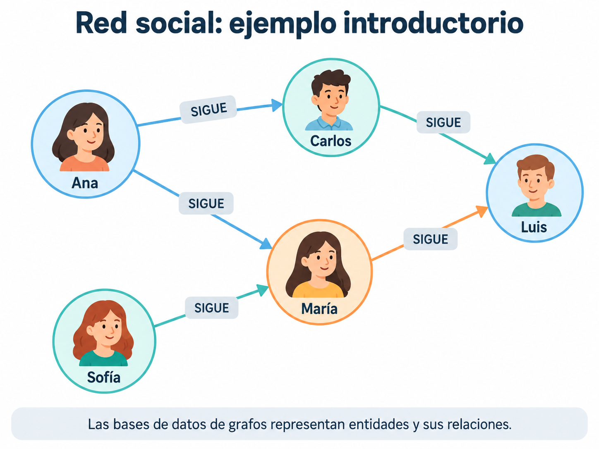{#fig-grafos-red-introduccion width="90%" fig-align="center"}

Como podemos observar en la @fig-grafos-red-introduccion, no solamente interesa almacenar el nombre de cada persona. También queremos responder preguntas como:

- ¿A quién sigue Ana?
- ¿Qué personas siguen a Luis?
- ¿Qué contactos tienen en común dos usuarios?
- ¿A quién podríamos recomendar seguir?

Para responderlas necesitamos conocer las conexiones entre las entidades.

::: {.callout-note}
## Idea clave

En una base de datos orientada a grafos, las relaciones entre los datos son parte fundamental del modelo.

Este enfoque resulta especialmente útil cuando necesitamos explorar conexiones, identificar patrones o recorrer relaciones entre entidades.
:::

En este apunte estudiaremos sus fundamentos.

Posteriormente utilizaremos **Neo4j** y el lenguaje **Cypher** para construir grafos y realizar consultas.

---

## ¿Qué es un grafo?

Un **grafo** es una estructura matemática utilizada para representar elementos y las conexiones que existen entre ellos.

Sus dos componentes fundamentales son:

- **Vértices o nodos:** representan elementos.
- **Aristas o relaciones:** representan conexiones entre esos elementos.

Imaginemos tres personas:

```text
Ana ───── Carlos ───── María
```

Cada persona es un nodo; cada línea es una conexión.

En un sistema real los nodos podrían representar personas, ciudades, productos, películas, dispositivos o artículos académicos.

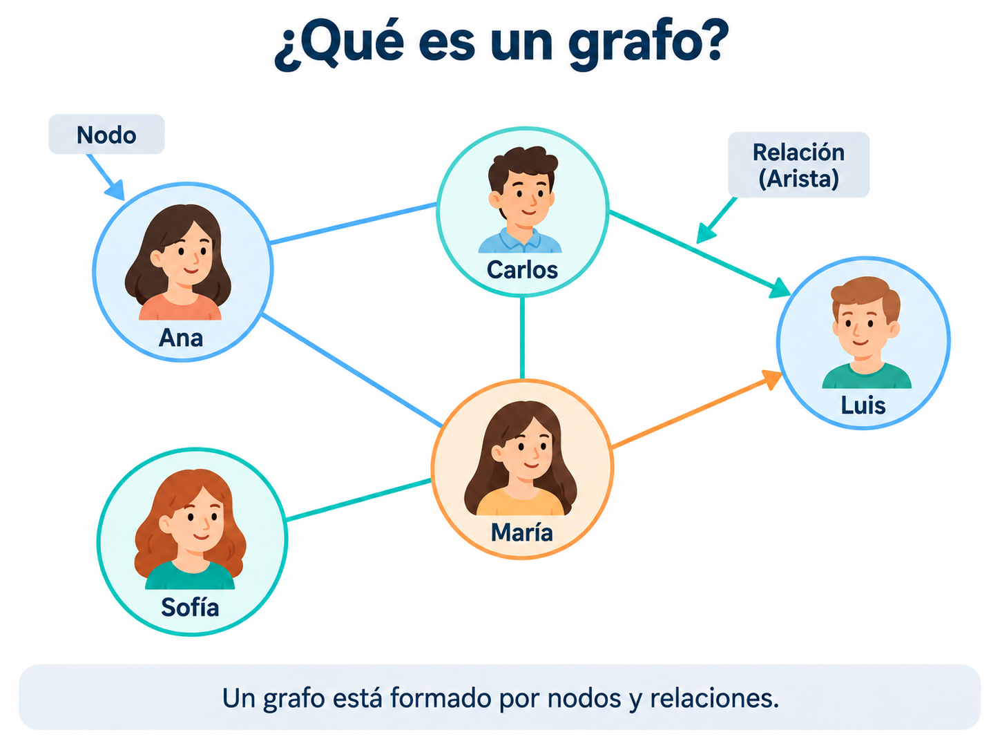{#fig-grafos-definicion width="85%" fig-align="center"}

La @fig-grafos-definicion permite identificar visualmente un nodo y una relación.

Los grafos se utilizan en:

- Redes sociales.
- Rutas de transporte.
- Redes de comunicación.
- Sistemas de recomendaciones.
- Relaciones familiares o académicas.
- Redes de conocimiento.

::: {.callout-tip}
## Una forma sencilla de entenderlo

Una tabla puede responder:

> ¿Cuáles son los datos de Ana?

Un grafo facilita representar otra pregunta:

> ¿Cómo está conectada Ana con María?
:::

---

## Elementos de una base de datos orientada a grafos

Para comprender el modelo estudiaremos tres elementos principales:

```text
NODOS
  +
RELACIONES
  +
PROPIEDADES
```

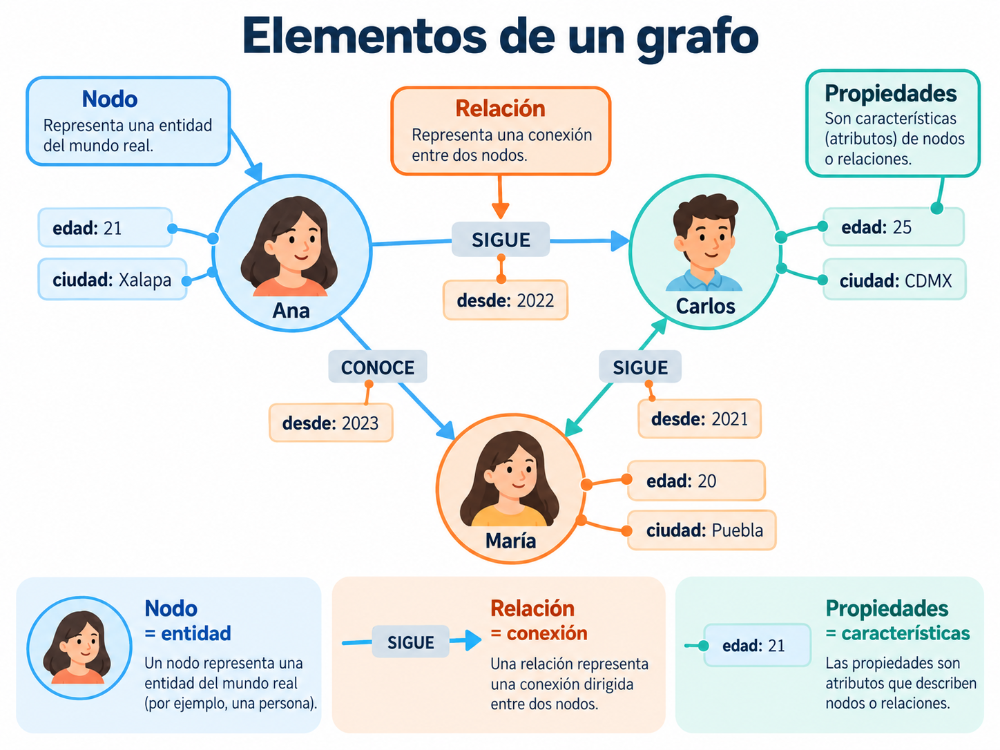{#fig-grafos-elementos width="95%" fig-align="center"}

### Nodos

Los **nodos** representan entidades dentro del sistema.

Por ejemplo:

```text
(Ana)    (Carlos)    (María)
```

En un sistema universitario podríamos representar:

```text
(Estudiante)    (Profesor)    (Materia)
```

Los nodos representan elementos identificables.

No indican por sí solos qué relación mantienen con otros elementos.

### Relaciones

Las **relaciones** conectan nodos y describen el tipo de conexión:

```text
(Ana) ─── CONOCE ───> (Carlos)

(Ana) ─── CURSA ────> (Bases de Datos)
```

Por lo tanto, una relación contiene significado: no es solamente una línea entre entidades.

### Propiedades

Las **propiedades** son atributos que describen nodos o relaciones.

Por ejemplo:

```text
Ana
├── edad: 21
├── ciudad: Xalapa
└── carrera: Ciencia de Datos
```

Una relación también puede tener propiedades:

```text
(Ana) ─── CONOCE ───> (Carlos)
             │
             └── desde: 2022
```

::: {.callout-note}
## Para recordar

- **Nodos:** entidades.
- **Relaciones:** conexiones.
- **Propiedades:** características de nodos o relaciones.
:::

---

## Etiquetas y tipos de relaciones

En una base de grafos como Neo4j, los nodos pueden clasificarse mediante **etiquetas**:

```text
Persona
Estudiante
Profesor
Materia
Universidad
```

Un mismo nodo puede tener más de una etiqueta.

Por ejemplo, Ana podría ser al mismo tiempo una persona y una estudiante:

```cypher
(:Persona:Estudiante)
```

Las relaciones también tienen tipos, como:

```text
SIGUE
CONOCE
CURSA
IMPARTE
COMPRÓ
PERTENECE_A
```

Por ejemplo:

```text
(Ana:Estudiante)
       │
       │ CURSA
       ↓
(Bases de Datos:Materia)
```

Este ejemplo muestra que las etiquetas describen **qué son los nodos**, mientras que los tipos de relación describen **cómo se conectan**.

---

## Grafos dirigidos y no dirigidos

Las conexiones entre nodos no siempre se interpretan de la misma manera.

En teoría de grafos distinguimos principalmente entre grafos **dirigidos** y **no dirigidos**.

### Grafo dirigido

En un **grafo dirigido**, las conexiones tienen una dirección:

```text
Ana ─── SIGUE ───> Carlos
```

Significa que Ana sigue a Carlos, pero **no implica** que Carlos siga a Ana.

Este tipo de conexión aparece en redes sociales donde los usuarios pueden seguir a otras personas sin que exista necesariamente una relación recíproca.

### Grafo no dirigido

En un **grafo no dirigido**, las conexiones no tienen una dirección:

```text
Ana ───── Carlos
```

Esto podría representar una amistad mutua o una conexión física, siempre que esa interpretación corresponda al problema.

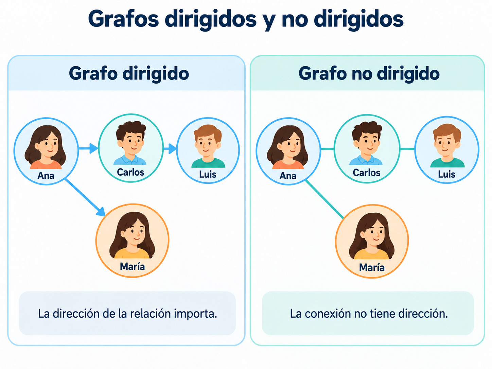{#fig-grafos-direccion width="95%" fig-align="center"}

La @fig-grafos-direccion permite observar la diferencia entre ambos tipos de conexiones.

::: {.callout-important}
## Una distinción importante

En Neo4j las relaciones almacenadas tienen dirección, pero sus consultas permiten buscar patrones sin exigir un sentido determinado.

Un grafo no dirigido, como concepto matemático, no es exactamente lo mismo que una consulta que ignora la dirección.
:::

---

## Ejemplo aplicado: una red social

Imaginemos una plataforma con cinco usuarios:

```text
Ana
Carlos
María
Luis
Sofía
```

Sus relaciones son:

```text
Ana ─── SIGUE ───> Carlos

Ana ─── SIGUE ───> María

Carlos ─ SIGUE ───> Luis

María ── SIGUE ───> Luis

Sofía ── SIGUE ───> María
```

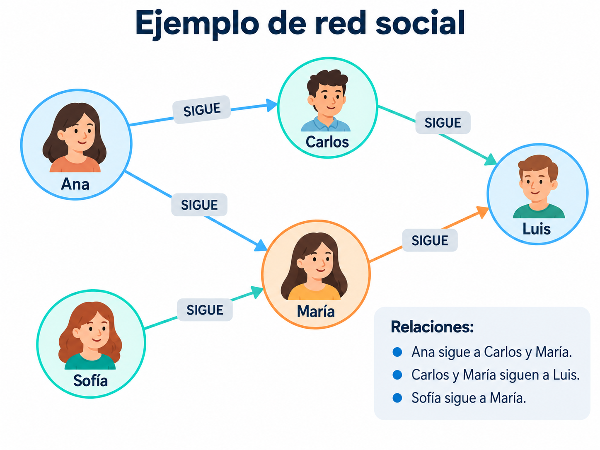{#fig-grafos-seguimientos width="95%" fig-align="center"}

A partir de la @fig-grafos-seguimientos podemos responder varias preguntas.

### ¿A quién sigue Ana?

La respuesta es:

```text
Carlos
María
```

### ¿Quiénes siguen a Luis?

La respuesta es:

```text
Carlos
María
```

### ¿A quién podríamos recomendar seguir a Ana?

Luis podría ser una recomendación candidata porque es seguido por dos personas a quienes Ana ya sigue.

Conceptualmente:

```text
Ana
 ├── sigue a Carlos ───> Luis
 │
 └── sigue a María ────> Luis
```

Esta es una aproximación sencilla a la lógica de algunos sistemas de recomendaciones.

En aplicaciones reales también pueden intervenir intereses, interacciones y otros criterios.

::: {.callout-tip}
## Recomendaciones mediante conexiones

Una aplicación puede explorar las relaciones de un usuario para identificar personas, productos o contenidos relacionados indirectamente.

Sin embargo, una recomendación real puede considerar muchos otros factores, como preferencias, actividad y comportamiento de los usuarios.
:::

---

## Relaciones directas e indirectas

Una relación **directa** conecta dos nodos mediante una sola arista.

Por ejemplo:

```text
Ana ───> Carlos
```

Una conexión **indirecta** se establece mediante nodos intermedios.

Por ejemplo:

```text
Ana ───> Carlos ───> Luis
```

Ana puede llegar a Luis por medio de Carlos.

También existe otro camino:

```text
Ana ───> María ───> Luis
```

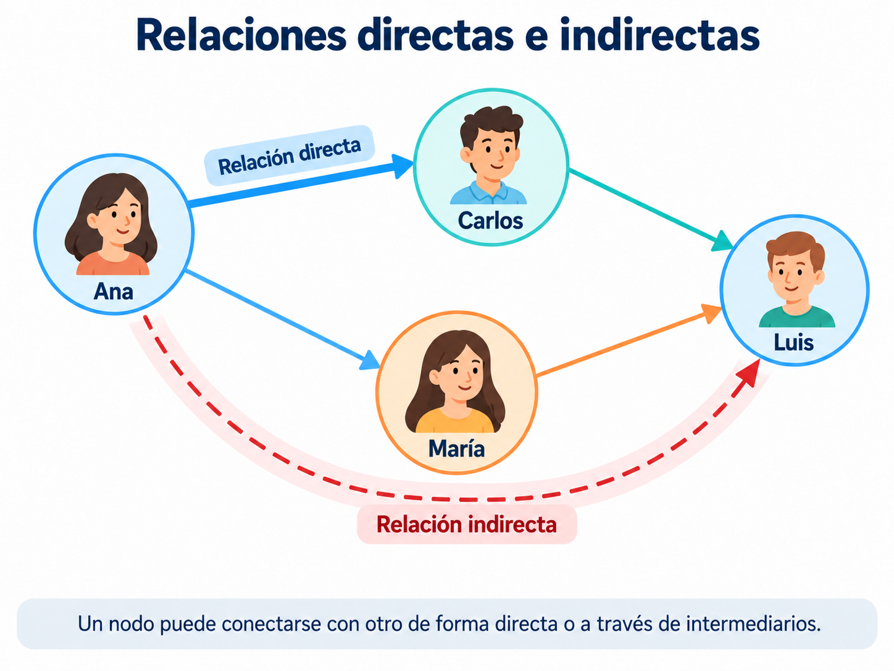{#fig-grafos-relaciones-indirectas width="90%" fig-align="center"}

### ¿Qué es un camino?

Un **camino** es una secuencia de nodos conectados mediante relaciones.

En el ejemplo:

```text
Ana → Carlos → Luis
```

el recorrido contiene **dos relaciones**, por lo que tiene longitud 2 si medimos su longitud por el número de aristas.

En un mismo grafo pueden existir diferentes caminos para conectar dos nodos.

::: {.callout-note}
## Idea clave

Las relaciones directas permiten consultar vecinos inmediatos.

Los caminos permiten explorar conexiones indirectas a través de uno o varios intermediarios.
:::

---

## Recorridos de grafos

Un **recorrido** consiste en explorar nodos y relaciones siguiendo determinadas condiciones.

Por ejemplo, partimos de Ana:

```text
Ana ───> Carlos ───> Luis
  └────> María ─────> Sofía
```

Podemos identificar dos niveles.

**Primer nivel:**

```text
Carlos
María
```

Son los nodos que se encuentran a una relación de Ana.

**Segundo nivel:**

```text
Luis
Sofía
```

Son los nodos a los que llegamos mediante dos relaciones.

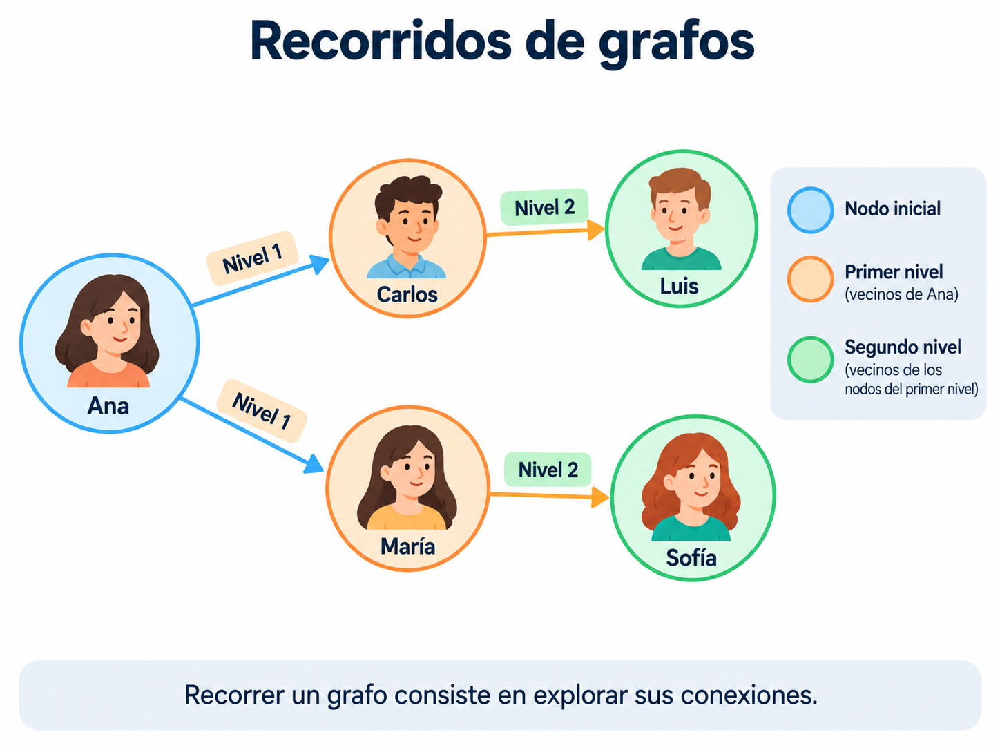{#fig-grafos-recorridos width="95%" fig-align="center"}

Los recorridos pueden servir para:

- Identificar contactos indirectos.
- Explorar redes de conocimiento.
- Encontrar conexiones entre personas.
- Analizar rutas y redes de transporte.
- Buscar patrones en sistemas de recomendaciones.

::: {.callout-tip}
## Para recordar

Una base de grafos permite consultar no solamente las propiedades de un nodo, sino también sus relaciones y las conexiones que pueden recorrerse a partir de él.
:::

---

## Comparación con una base de datos relacional

Pensemos nuevamente en una red social.

En el modelo relacional podríamos almacenar personas en una tabla.

### Tabla `usuarios`

| id_usuario | nombre |
|---:|---|
| 1 | Ana |
| 2 | Carlos |
| 3 | María |
| 4 | Luis |

Para representar los seguimientos podríamos usar otra tabla.

### Tabla `seguimientos`

| usuario_origen | usuario_destino |
|---:|---:|
| 1 | 2 |
| 1 | 3 |
| 2 | 4 |
| 3 | 4 |

La primera fila significa que Ana sigue a Carlos.

Esta representación es válida y útil.

En un modelo de grafos, las conexiones se representan explícitamente mediante relaciones entre nodos.

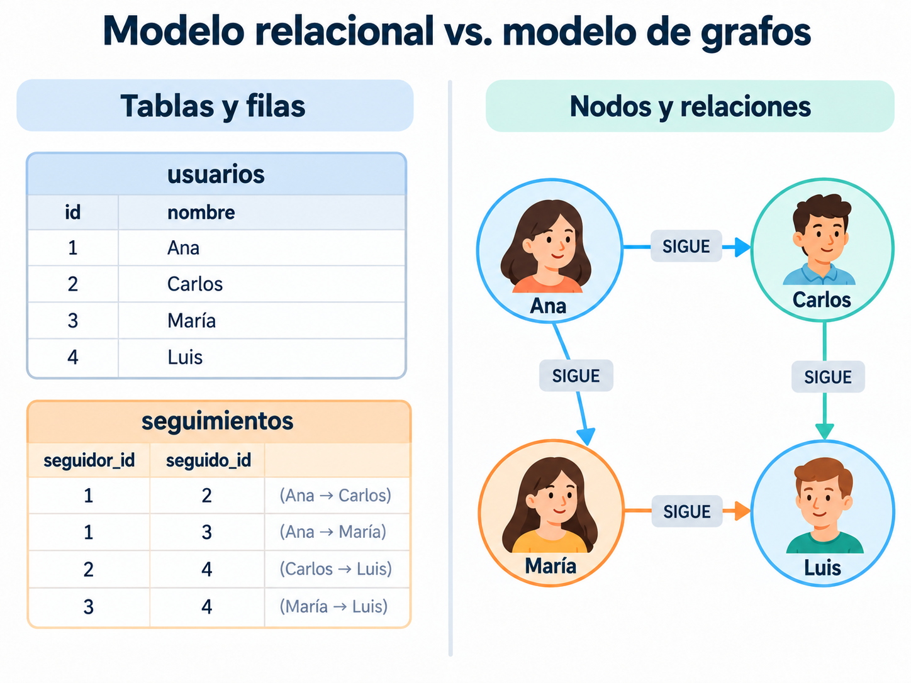{#fig-grafos-comparacion-relacional width="95%" fig-align="center"}

| Característica | Modelo relacional | Modelo de grafos |
|---|---|---|
| Organización | Tablas | Nodos y relaciones |
| Entidades | Filas | Nodos |
| Conexiones | Llaves y tablas relacionadas | Relaciones explícitas |
| Atributos | Columnas | Propiedades |
| Lenguaje habitual | SQL | Cypher, entre otros |
| Consultas de varios niveles | `JOIN` y consultas recursivas | Recorridos y patrones |
| Gestor de ejemplo | PostgreSQL | Neo4j |

::: {.callout-warning}
## Importante

Las bases de datos relacionales también permiten consultar relaciones complejas y realizar consultas recursivas.

Los grafos no reemplazan automáticamente a las bases relacionales.

La ventaja depende del problema y de las consultas que se necesitan realizar.
:::

---

## Comparación con una base documental

MongoDB permite almacenar referencias o información incrustada.

Por ejemplo:

```javascript
{
  nombre: "Ana",
  edad: 21,
  siguiendo: ["Carlos", "María"]
}
```

Ese documento permite conocer a quién sigue Ana.

Pero si queremos saber a quiénes siguen Carlos y María, necesitamos recuperar información adicional.

En un grafo podemos representar las conexiones directamente:

```text
Ana ───> Carlos ───> Luis
  └────> María ─────> Luis
```

| Modelo documental | Modelo de grafos |
|---|---|
| Documentos con campos y valores | Nodos con propiedades |
| Información incrustada o referenciada | Conexiones explícitas |
| Consultas de documentos | Consultas de patrones y recorridos |
| Ejemplo: MongoDB | Ejemplo: Neo4j |

::: {.callout-tip}
## ¿Cuándo conviene cada modelo?

El modelo documental puede ser adecuado cuando almacenamos información que se consulta junta.

El modelo de grafos puede ser más conveniente cuando el interés principal es recorrer y analizar conexiones entre entidades.
:::

---

## Ejemplo: sistema de recomendaciones de películas

Una plataforma de streaming podría representar usuarios, películas y géneros como nodos.

Imaginemos que:

- Ana vio las películas A y B.
- Carlos vio las películas A y C.
- La película A y la C pertenecen a Ciencia ficción.
- La película B pertenece a Drama.

Podemos representarlo así:

```text
Ana ── VIO ──> Película A <── VIO ── Carlos
 │                                   │
 └── VIO ───> Película B              │
                                     │
                                  VIO│
                                     ↓
                                 Película C
```

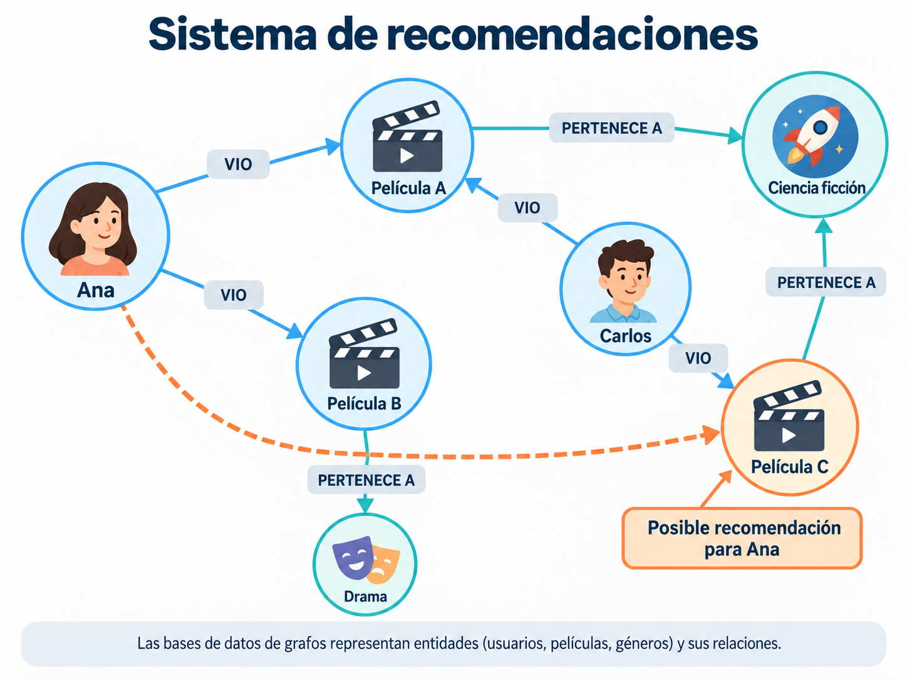{#fig-grafos-recomendaciones width="95%" fig-align="center"}

En este ejemplo, la película C podría considerarse una recomendación candidata para Ana porque Carlos la vio y ambos comparten el antecedente de haber visto la película A.

Las relaciones también permiten explorar:

- Películas vistas por usuarios con intereses comunes.
- Películas que pertenecen al mismo género.
- Usuarios que comparten contenidos.
- Recomendaciones potenciales.

::: {.callout-note}
## Una recomendación no es una certeza

El hecho de compartir una película no garantiza que dos usuarios tengan los mismos gustos.

En una aplicación real conviene combinar las conexiones con otros datos y criterios.
:::

---

## Ejemplo: rutas de transporte

Los grafos también permiten representar redes de transporte.

Por ejemplo:

```text
Xalapa ───── Veracruz
  │                │
  │                │
Puebla ─── Ciudad de México
```

Cada ciudad representa un nodo y cada conexión representa una ruta.

Las relaciones pueden contener propiedades como:

```text
distancia
tiempo
costo
```

Por ejemplo, imaginemos datos ficticios:

```text
Ciudad A ─── 10 km ─── Ciudad B

Ciudad B ─── 15 km ─── Ciudad C
```

Si una conexión tiene un valor numérico asociado, hablamos de un **grafo ponderado**.

Con los pesos podemos estudiar caminos que minimicen distancia, tiempo o costo.

::: {.callout-note}
## Grafos ponderados

En un grafo ponderado, las aristas tienen valores numéricos llamados pesos.

El significado de esos valores depende del problema.
:::

---

## Ejemplo: relaciones académicas

Imaginemos una universidad con estudiantes, docentes y materias:

```text
Ana ───── CURSA ─────> Bases de Datos

Luis ──── CURSA ─────> Bases de Datos

Carlos ── IMPARTE ───> Bases de Datos
```

Las entidades podrían ampliarse para incluir:

```text
facultades
programas educativos
proyectos
áreas de investigación
```

Con este grafo podríamos preguntar:

- ¿Qué materias cursa una persona?
- ¿Quién imparte cierta materia?
- ¿Qué estudiantes comparten materias?
- ¿Qué docentes colaboran en un proyecto?
- ¿Qué programas educativos comparten asignaturas?

Este ejemplo muestra cómo un grafo permite integrar diferentes entidades alrededor de sus relaciones.

---

## Grafos y Ciencia de Datos

Representar información como red permite analizar características de su estructura.

### Análisis de redes sociales

Permite estudiar interacciones y conexiones entre personas o comunidades.

Por ejemplo:

```text
personas
   ↓
relaciones
   ↓
estructura de una red social
```

### Sistemas de recomendación

Pueden utilizar conexiones entre usuarios, productos, películas e intereses para identificar candidatos a recomendar.

### Detección de comunidades

Consiste en identificar grupos de nodos con determinados patrones de conexión.

Por ejemplo, dentro de una red social podrían existir conjuntos de personas que interactúan con mayor frecuencia entre sí.

### Detección de patrones inusuales

En redes de cuentas, transacciones o dispositivos pueden estudiarse conexiones poco frecuentes o inusuales como parte de un análisis de anomalías.

### Redes de conocimiento

Podemos representar relaciones entre publicaciones, autores y conceptos:

```text
Artículo A ─── CITA ───> Artículo B

Artículo B ─── CITA ───> Artículo C
```

Esta representación puede utilizarse para analizar redes de citas académicas.

---

## Conceptos básicos del análisis de grafos

### Grado de un nodo

El **grado** es la cantidad de aristas incidentes a un nodo en un grafo no dirigido.

```text
      Carlos
         |
         |
Ana ─── María ─── Luis
```

En este ejemplo, María tiene **grado 3**.

En grafos dirigidos se distingue entre:

- **Grado de entrada:** cantidad de relaciones que llegan al nodo.
- **Grado de salida:** cantidad de relaciones que salen del nodo.

Por ejemplo:

```text
Ana ───> María

Luis ───> María

María ──> Carlos
```

María tiene:

```text
grado de entrada = 2

grado de salida = 1
```

### Caminos más cortos

Se busca un camino mínimo entre dos nodos según el criterio elegido.

Si todas las relaciones tienen el mismo costo, podemos minimizar la cantidad de aristas.

Si existen pesos, podemos buscar el menor costo total.

### Centralidad

La **centralidad** reúne diferentes medidas que describen la posición o importancia estructural de un nodo en una red.

Algunas consideran:

- La cantidad de conexiones.
- Las distancias hacia otros nodos.
- Su participación en caminos.
- Las conexiones con otros nodos importantes.

No existe una única medida adecuada para todos los problemas.

### Comunidades

Son grupos de nodos que muestran patrones de conexión relativamente más intensos entre sus integrantes, según el criterio o algoritmo utilizado.

Por ejemplo, en una red social puede haber grupos de personas con numerosos vínculos dentro de cada grupo y menos conexiones entre grupos diferentes.

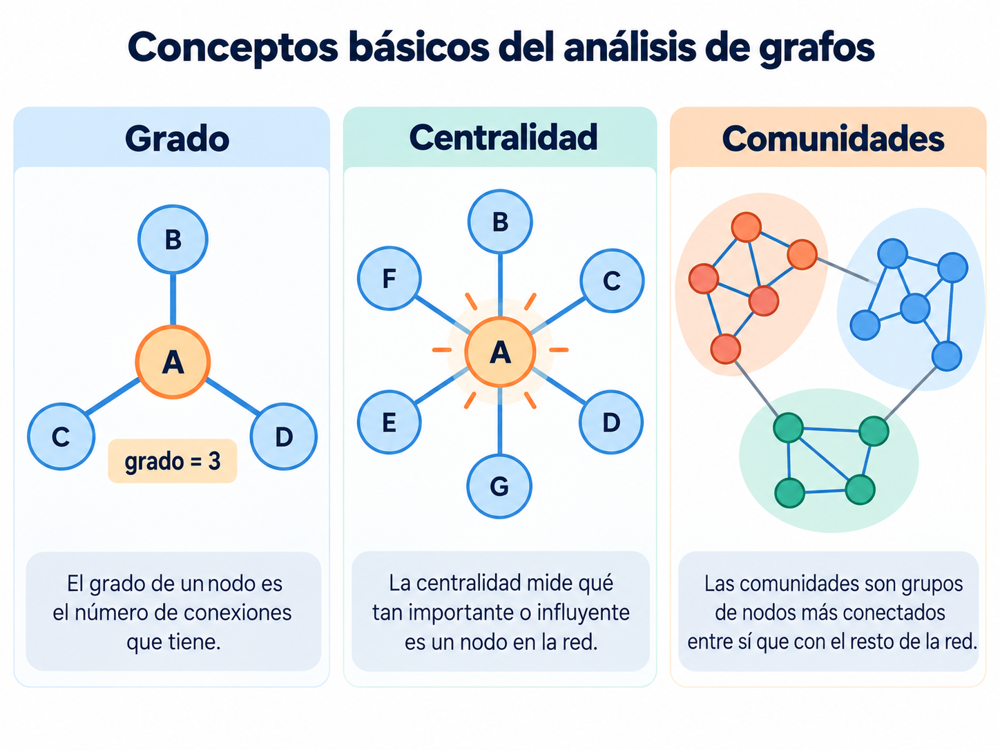{#fig-grafos-conceptos-analisis width="95%" fig-align="center"}

::: {.callout-tip}
## Para Ciencia de Datos

Una base de grafos permite almacenar y consultar conexiones.

Posteriormente, técnicas de análisis de redes permiten estudiar caminos, centralidad, comunidades y otros patrones.
:::

---

## Ventajas del modelo de grafos

Entre las principales ventajas podemos mencionar:

- Representa explícitamente las relaciones entre entidades.
- Facilita modelar redes de información.
- Permite recorrer conexiones directas e indirectas.
- Facilita consultas basadas en patrones de relaciones.
- Representa diferentes tipos de nodos y conexiones.
- Resulta útil en recomendaciones, rutas y análisis de redes.

Estas ventajas deben evaluarse siempre en función del problema.

---

## Limitaciones y consideraciones

También existen limitaciones:

- No todas las aplicaciones requieren explorar relaciones complejas.
- Algunas consultas tabulares son más naturales en una base relacional.
- Los recorridos muy amplios pueden utilizar muchos recursos.
- El rendimiento depende de la estructura y el tamaño del grafo.
- Distribuir grafos entre varios servidores puede introducir retos adicionales.
- Los nodos y relaciones necesitan un diseño adecuado.

::: {.callout-warning}
## No utilizar grafos para cualquier problema

Una base de datos orientada a grafos no es automáticamente mejor que una relacional, documental o clave–valor.

Debemos elegirla en función de las consultas y las relaciones que realmente necesitamos.
:::

---

## Neo4j como ejemplo de base de datos de grafos

**Neo4j** es uno de los gestores más conocidos de bases de datos orientadas a grafos.

Utiliza un modelo denominado **grafo de propiedades** (*property graph*).

Permite representar:

```text
nodos
relaciones
etiquetas
tipos de relaciones
propiedades
```

Por ejemplo:

```text
(Ana:Persona) ─── SIGUE ───> (Carlos:Persona)
```

### Lenguaje Cypher

Neo4j utiliza **Cypher**, un lenguaje que describe patrones mediante una sintaxis parecida a la representación visual de los grafos.

Por ejemplo, el siguiente patrón representa una conexión; **todavía no es una instrucción completa para crearla**:

```cypher
(ana)-[:SIGUE]->(carlos)
```

Los paréntesis representan nodos:

```cypher
()
```

Los corchetes describen relaciones:

```cypher
[]
```

Y la flecha indica la dirección:

```cypher
-[]->
```

En el próximo tema utilizaremos instrucciones como:

```cypher
CREATE
MATCH
RETURN
WHERE
SET
DELETE
```

para trabajar directamente con Neo4j.

---

## Comparación de los cuatro modelos NoSQL

Hasta ahora hemos estudiado los cuatro modelos principales de bases de datos NoSQL.

| Modelo | Organización principal | Tecnología estudiada |
|---|---|---|
| Documental | Documentos con campos y valores | MongoDB |
| Clave–valor | Claves asociadas con valores | Redis |
| Familias de columnas | Tablas, particiones y columnas | Cassandra |
| Grafos | Nodos, relaciones y propiedades | Neo4j (siguiente práctica) |

### Modelo documental

Útil para documentos con estructuras anidadas y atributos variables.

### Modelo clave–valor

Conveniente cuando conocemos la clave y necesitamos recuperar o actualizar rápidamente un valor.

### Modelo de familias de columnas

Adecuado para ciertos escenarios de gran volumen de información distribuida y consultas orientadas por claves de partición.

### Modelo de grafos

Especialmente útil cuando debemos explorar y analizar conexiones entre entidades.

::: {.callout-note}
## Idea principal

No existe un único modelo adecuado para todos los problemas.

La elección depende de:

- La estructura de los datos.
- Las relaciones existentes.
- Las consultas necesarias.
- El volumen de información.
- Los requisitos de rendimiento.
- La distribución y escalabilidad.
:::

---

## Ejemplo integrado: una plataforma digital

Imaginemos una aplicación que registra usuarios, muestra películas, administra sesiones, almacena actividad y recomienda contenido.

Podríamos considerar diferentes modelos de almacenamiento.

**MongoDB** podría almacenar:

```text
Perfiles de usuarios
Información de películas
Metadatos
```

**Redis** podría utilizarse para:

```text
Sesiones
Caché
Contadores
```

**Cassandra** podría conservar:

```text
Historiales de reproducción
Eventos generados continuamente
Registros de actividad
```

**Neo4j** podría modelar:

```text
Relaciones entre usuarios
Intereses compartidos
Relaciones entre contenidos
Candidatos para recomendaciones
```

Esta combinación es conceptual.

En aplicaciones reales hace falta diseñar cómo se comunican los sistemas y cómo mantienen la información coherente.

La utilización de diferentes tecnologías de almacenamiento se relaciona con la **persistencia políglota**.

---

## Actividad de autoevaluación

Relaciona cada situación con un concepto del tema.

| Situación | Concepto |
|---|---|
| Una persona dentro de una red social | ___ |
| La conexión entre dos personas | ___ |
| La edad almacenada de una persona | ___ |
| Ana sigue a Carlos, pero Carlos no necesariamente sigue a Ana | ___ |
| Ana está conectada con Luis mediante Carlos | ___ |
| Explorar conexiones a partir de un usuario | ___ |
| Cantidad de aristas incidentes a un nodo en un grafo no dirigido | ___ |
| Encontrar grupos de usuarios relacionados | ___ |
| Lenguaje utilizado para consultar Neo4j | ___ |
| Gestor de bases de datos de grafos | ___ |

::: {.callout-tip collapse="true"}
## Posibles respuestas

1. Nodo.
2. Relación.
3. Propiedad.
4. Relación dirigida.
5. Camino o conexión indirecta.
6. Recorrido.
7. Grado.
8. Comunidades.
9. Cypher.
10. Neo4j.
:::

---

## Preguntas para reflexionar

1. ¿Qué diferencia existe entre un nodo y una relación?

2. ¿Por qué las conexiones tienen tanta importancia en una base de grafos?

3. ¿Qué es una propiedad y dónde puede almacenarse?

4. ¿Cuál es la diferencia entre un grafo dirigido y uno no dirigido?

5. ¿Qué diferencia existe entre una conexión directa y una indirecta?

6. ¿Qué significa recorrer un grafo?

7. ¿Cómo podría usarse un grafo para recomendar personas dentro de una red social?

8. ¿Qué diferencias hay entre representar relaciones mediante tablas y mediante grafos?

9. ¿En qué situaciones podría convenir MongoDB en lugar de Neo4j?

10. ¿Qué aplicaciones de grafos identificas dentro de Ciencia de Datos?

11. ¿Qué representa el grado de un nodo?

12. ¿Por qué una base de grafos no es necesariamente la mejor opción para cualquier sistema?

---

## Ideas clave

::: {.callout-note}
## 1. Los grafos representan entidades y conexiones

Los nodos representan entidades y las relaciones representan sus conexiones.

Ambos pueden almacenar propiedades.
:::

::: {.callout-note}
## 2. Las conexiones pueden tener dirección

Una relación dirigida distingue quién inicia y quién recibe una conexión.

Las relaciones no dirigidas no presentan ese sentido.
:::

::: {.callout-note}
## 3. Los recorridos permiten explorar la red

Podemos estudiar conexiones inmediatas, caminos indirectos y diferentes niveles de relación.
:::

::: {.callout-note}
## 4. Los grafos tienen aplicaciones en Ciencia de Datos

Permiten estudiar recomendaciones, redes sociales, rutas, comunidades, centralidad y redes de conocimiento.
:::

::: {.callout-note}
## 5. Neo4j utiliza grafos de propiedades

Neo4j organiza la información mediante nodos y relaciones.

Cypher permite describir y consultar patrones.
:::

::: {.callout-note}
## 6. El problema determina el modelo

MongoDB, Redis, Cassandra y Neo4j responden a diferentes necesidades.

La elección debe basarse en el tipo de información y en las consultas que realizará la aplicación.
:::

---

## De los grafos sencillos a las redes complejas

Hasta ahora hemos trabajado con ejemplos relativamente pequeños para comprender los principales elementos de las bases de datos orientadas a grafos.

En nuestros primeros ejemplos utilizamos cuatro o cinco personas para identificar nodos, relaciones, propiedades y recorridos.

Sin embargo, en aplicaciones reales podemos encontrar grafos mucho más grandes, donde existen diferentes tipos de entidades y numerosas conexiones.

Por ejemplo, una red podría integrar:

- Personas.
- Empresas.
- Libros.
- Temas de interés.
- Proyectos.
- Eventos.
- Herramientas tecnológicas.
- Organizaciones.

En este tipo de escenario, no solamente interesa conocer las características de cada entidad, sino también descubrir **cómo se relacionan entre sí**.

### Ejemplo de un grafo más complejo

Imaginemos una aplicación que almacena información sobre personas, libros, empresas y áreas de conocimiento.

En ella podríamos registrar relaciones como:

```text
Ana ─── TRABAJA_EN ───> TechSolutions

Carlos ─── AUTOR_DE ───> Bases de Datos Modernas

María ─── AUTOR_DE ───> Diseño de Software

TechSolutions ─── DESARROLLA ───> Plataforma de Análisis

Plataforma de Análisis ─── UTILIZA ───> Neo4j
```

Estas relaciones pueden formar parte de una misma red.

{#fig-grafos-complejo width="100%" fig-align="center"}

En la @fig-grafos-complejo observamos que los nodos representan diferentes tipos de entidades.

También encontramos distintas relaciones, como:

- `AMIGO_DE`: conecta personas.
- `TRABAJA_EN`: conecta personas con empresas.
- `AUTOR_DE`: conecta personas con libros.
- `LE_GUSTA`: relaciona personas con temas de interés.
- `DESARROLLA`: conecta organizaciones con proyectos.
- `UTILIZA`: relaciona proyectos con herramientas.

A partir de esta estructura podríamos responder preguntas como:

- ¿Qué personas trabajan en la misma empresa?
- ¿Qué libros escribieron los empleados de determinada organización?
- ¿Qué temas de interés comparten dos personas?
- ¿Qué proyectos utilizan una herramienta específica?
- ¿Qué conexiones existen entre una persona y determinado libro?

Este ejemplo permite observar que un grafo puede integrar diferentes tipos de información dentro de una sola estructura.

::: {.callout-note}
## Idea importante

La principal característica del modelo de grafos no es solamente que pueda almacenar diferentes entidades.

Su valor está en permitir representar y explorar las relaciones que existen entre ellas.
:::

---

### ¿Qué sucede cuando una red crece?

Ahora imaginemos que nuestra aplicación deja de trabajar con unas cuantas personas y comienza a almacenar información sobre miles de usuarios, organizaciones, proyectos y áreas de conocimiento.

Cada nuevo elemento puede agregar:

```text
nuevos nodos
     +
nuevas relaciones
     ↓
una red más grande
```

Por ejemplo, una plataforma podría contener:

```text
10,000 usuarios

2,000 proyectos

500 organizaciones

1,000 temas de interés
```

Estos valores son únicamente ilustrativos.

Además, un mismo usuario podría relacionarse con numerosos proyectos, organizaciones y temas.

Como consecuencia, la red podría contener una cantidad mucho mayor de conexiones que de entidades.

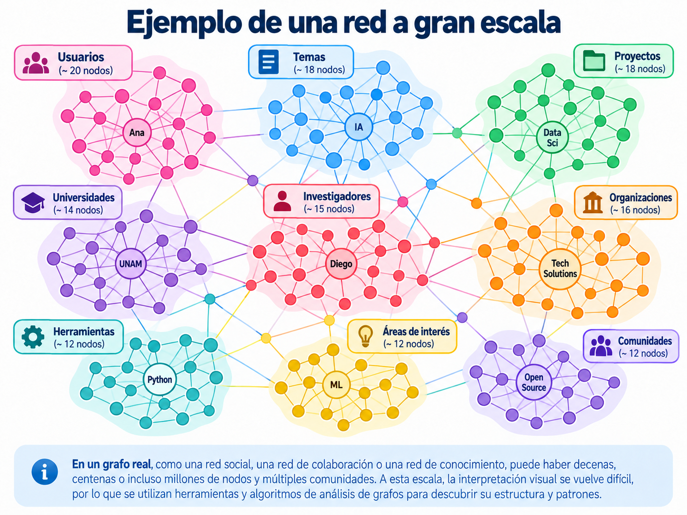{#fig-grafos-gran-escala width="100%" fig-align="center"}

En la @fig-grafos-gran-escala podemos observar una red más grande donde los nodos aparecen agrupados en diferentes conjuntos.

Cada grupo representa conceptualmente un conjunto de entidades relacionadas, como:

- Usuarios.
- Universidades.
- Investigadores.
- Proyectos.
- Organizaciones.
- Herramientas.
- Áreas de interés.

Algunos nodos mantienen numerosas conexiones dentro de su propio grupo.

Otros permiten conectar diferentes grupos de la red.

Esta estructura puede estudiarse mediante técnicas de análisis de grafos para identificar comunidades y patrones de conexión.

::: {.callout-warning}
## Una red grande no siempre es fácil de interpretar

Cuando tenemos cientos, miles o millones de nodos, visualizar todas las conexiones al mismo tiempo puede resultar poco práctico.

Por ello, las bases de datos de grafos permiten realizar consultas específicas y recuperar únicamente una parte de la información.

No siempre necesitamos visualizar toda la red para responder una pregunta.
:::

---

### Explorar solamente una parte del grafo

Supongamos que nuestra red contiene una gran cantidad de personas, empresas, proyectos y libros.

Sin embargo, queremos responder una pregunta concreta:

> ¿Con qué entidades está relacionada Ana?

Para ello no necesitamos analizar visualmente todas las conexiones de la red.

Podemos comenzar desde el nodo que representa a Ana y explorar sus relaciones.

Por ejemplo:

```text
                Ana
                 │
       ┌─────────┼─────────┐
       │         │         │
     Carlos    María   TechSolutions
       │         │         │
       ↓         ↓         ↓
     Libro     Tema      Proyecto
```

En este caso distinguimos dos niveles de conexiones.

**Primer nivel:** nodos conectados directamente con Ana.

**Segundo nivel:** nodos a los que podemos llegar mediante una entidad intermedia.

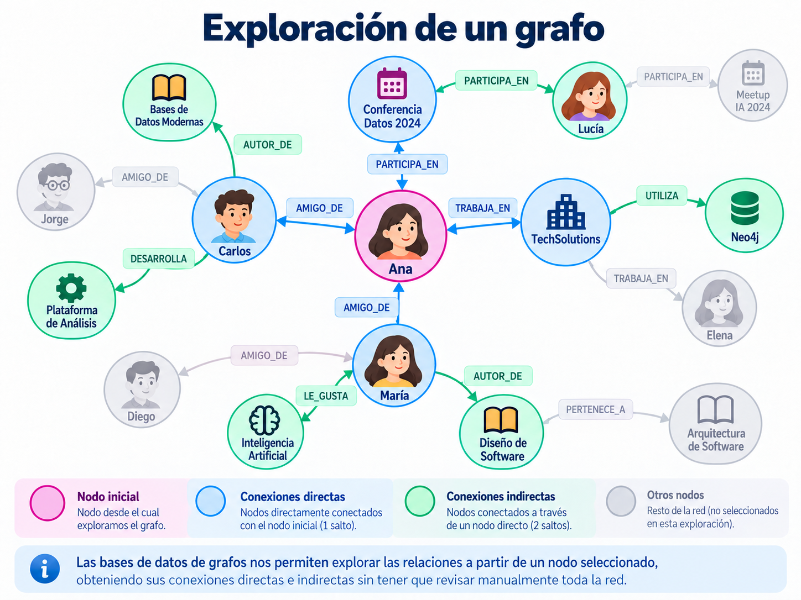{#fig-grafos-exploracion-compleja width="100%" fig-align="center"}

En la @fig-grafos-exploracion-compleja podemos observar cómo algunas conexiones aparecen destacadas mientras que otras permanecen en segundo plano.

Esto permite concentrarnos en un nodo y en su entorno cercano.

Por ejemplo, una consulta podría buscar:

- Las personas relacionadas con Ana.
- Las organizaciones donde trabaja.
- Los eventos en los que participa.
- Los libros relacionados con sus contactos.
- Los proyectos conectados con su empresa.

::: {.callout-tip}
## ¿Por qué son importantes los recorridos?

Los recorridos permiten explorar una parte de la red a partir de un nodo inicial.

En lugar de revisar manualmente cientos de conexiones, podemos utilizar consultas para recuperar los nodos y relaciones que cumplen determinadas condiciones.

Esta es una de las principales razones por las que las bases de datos orientadas a grafos resultan útiles en sistemas donde las conexiones tienen especial importancia.
:::

---