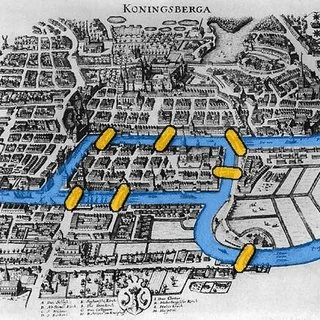
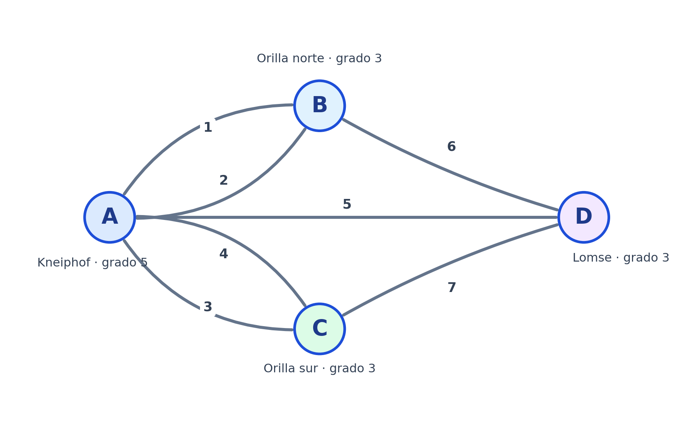
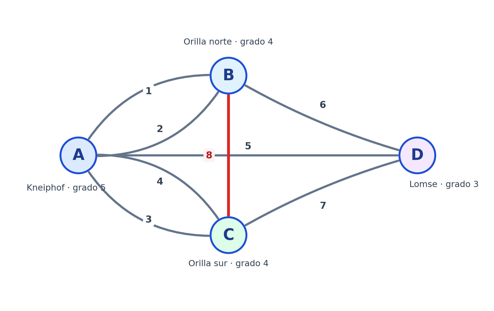

## Introducción

El problema de los siete puentes de Königsberg es uno de los antecedentes más importantes de la teoría de grafos.

En 1736, el matemático Leonhard Euler estudió si era posible recorrer todos los puentes de una ciudad atravesando cada uno exactamente una vez.

Este problema permitió desarrollar conceptos fundamentales de la teoría de grafos, como el grado de los nodos y los caminos eulerianos.

En este apunte representaremos el problema mediante un grafo, lo construiremos en Neo4j y utilizaremos una demostración matemática para determinar si existe un recorrido válido.

## El problema de los siete puentes de Königsberg

La ciudad de Königsberg, actualmente Kaliningrado, estaba atravesada por el río Pregel.

El río dividía la ciudad en cuatro zonas de tierra, conectadas mediante siete puentes.

El desafío consistía en responder la siguiente pregunta:

> **¿Es posible recorrer los siete puentes, atravesando cada uno exactamente una vez, sin importar dónde comienza o termina el recorrido?**

### Representación histórica de la ciudad

{fig-align="center" width="70%"}

### Planteamiento del desafío

Observa el mapa anterior e imagina que estás caminando por la ciudad.

Tu objetivo es atravesar los siete puentes, pero debes cumplir una condición: **cada puente solamente puede cruzarse una vez**.

Puedes comenzar en cualquiera de las cuatro zonas y terminar donde quieras.

Antes de continuar, intenta responder:

1. ¿Qué recorrido seguirías para cruzar los siete puentes?
2. ¿Podrías comenzar en otra zona y conseguirlo?
3. ¿Qué sucede cuando llegas a una zona y ya utilizaste todos los puentes por los que podrías salir?

::: {.callout-tip collapse="true" title="Ver una pista"}

No es necesario visitar cada zona una sola vez.

Puedes regresar a una zona tantas veces como quieras, siempre que no vuelvas a cruzar un puente que ya utilizaste.

La condición se aplica a los **puentes**, no a las zonas de tierra.

:::

Por ahora no necesitamos conocer la respuesta. Primero representaremos la ciudad mediante un grafo y estudiaremos sus conexiones.

## Representación matemática del problema

En teoría de grafos, podemos representar las zonas de tierra mediante **nodos** y los puentes mediante **aristas**.

En nuestro ejemplo:

| Nodo | Zona de tierra |
|---|---|
| A | Isla de Kneiphof |
| B | Orilla norte |
| C | Orilla sur |
| D | Isla de Lomse |

Cada puente representa una conexión entre dos zonas de tierra.

### Grafo de los siete puentes

{fig-align="center" width="75%"}

El grafo contiene cuatro nodos y siete aristas.

Algunas zonas están conectadas mediante más de un puente.

Por ejemplo, entre A y B existen dos conexiones diferentes.

Este tipo de estructura se conoce como **multigrafo**, porque permite tener varias aristas entre los mismos nodos.

Para este problema consideraremos los puentes como conexiones no dirigidas, es decir, que pueden cruzarse en cualquiera de los dos sentidos.

### Identificación de los puentes

Para trabajar con Neo4j, identificaremos cada puente mediante un número.

| Puente | Conexión |
|---|---|
| 1 | A – B |
| 2 | A – B |
| 3 | A – C |
| 4 | A – C |
| 5 | A – D |
| 6 | B – D |
| 7 | C – D |

Cada puente tendrá su propio número para distinguirlo de los demás, incluso cuando conecte las mismas zonas.


## Creación del grafo en Neo4j

Ahora construiremos el problema utilizando Neo4j y el lenguaje Cypher.

Utilizaremos la etiqueta `Zona` y las relaciones de tipo `PUENTE` para distinguir este ejemplo de los grafos que trabajamos anteriormente.

### Creación de las cuatro zonas de tierra

Ejecuta la siguiente consulta:

```sql
UNWIND [
  ['A', 'Kneiphof'],
  ['B', 'Orilla norte'],
  ['C', 'Orilla sur'],
  ['D', 'Lomse']
] AS datos

MERGE (zona:Zona {nombre: datos[0]})
SET zona.descripcion = datos[1]

RETURN zona;
```

**Resultado esperado:** cuatro nodos con la etiqueta `Zona`.

Cada nodo tendrá las propiedades `nombre` y `descripcion`.

### Creación de los siete puentes

```sql
UNWIND [
  ['A', 'B', 1],
  ['A', 'B', 2],
  ['A', 'C', 3],
  ['A', 'C', 4],
  ['A', 'D', 5],
  ['B', 'D', 6],
  ['C', 'D', 7]
] AS datos

MATCH (origen:Zona {nombre: datos[0]})
MATCH (destino:Zona {nombre: datos[1]})

MERGE (origen)-[puente:PUENTE {numero: datos[2]}]->(destino)

RETURN COUNT(puente) AS PuentesProcesados;
```

**Resultado esperado:** 7 puentes procesados.

Cada registro contiene el origen, el destino y el número del puente.

Utilizamos `MERGE` para identificar cada puente mediante su número y evitar crear nuevamente la misma relación al repetir la consulta.

Es importante conservar los números porque existen varios puentes que conectan las mismas zonas.

Aunque Neo4j almacena las relaciones con una dirección, para este problema las analizaremos en ambos sentidos.

### Verificación del número de nodos

```sql
MATCH (zona:Zona)
RETURN COUNT(zona) AS TotalZonas;
```

**Resultado esperado:** 4 zonas.

### Verificación del número de puentes

```sql
MATCH (:Zona)-[puente:PUENTE]->(:Zona)
RETURN COUNT(puente) AS TotalPuentes;
```

**Resultado esperado:** 7 puentes.

### Visualización del grafo en Neo4j

```sql
MATCH (origen:Zona)-[puente:PUENTE]->(destino:Zona)
RETURN origen, puente, destino;
```

Selecciona la vista **Graph** para observar las cuatro zonas conectadas mediante siete relaciones.

## Grado de los nodos

El **grado de un nodo** es la cantidad de aristas conectadas con él.

En el problema de Königsberg, representa la cantidad de puentes que llegan a cada zona de tierra.

### Calcular el grado de cada nodo

```sql
MATCH (zona:Zona)
OPTIONAL MATCH (zona)-[puente:PUENTE]-()

RETURN zona.nombre AS Zona,
       COUNT(puente) AS Grado

ORDER BY Zona;
```

**Resultado esperado:**

| Zona | Grado |
|---|---:|
| A | 5 |
| B | 3 |
| C | 3 |
| D | 3 |

Observa que utilizamos `-[puente:PUENTE]-` sin flecha, porque estamos contando los puentes independientemente de su dirección.

Todos los nodos tienen grado impar.

## Demostración matemática: ¿por qué no existe solución?

Ya representamos la ciudad mediante un grafo y comprobamos que tiene cuatro nodos y siete puentes.

Ahora queremos demostrar matemáticamente por qué no es posible recorrer todos los puentes exactamente una vez.

Para comprenderlo utilizaremos dos conceptos: el **grado de los nodos** y el **camino euleriano**.

### ¿Qué es un camino euleriano?

Un camino euleriano es un recorrido que atraviesa todas las aristas de un grafo exactamente una vez.

En el problema de Königsberg, esto significa cruzar los siete puentes sin repetir ninguno.

Es importante recordar que podemos visitar una misma zona varias veces. La restricción consiste únicamente en no atravesar nuevamente un puente.

### ¿Por qué importa el grado de los nodos?

Recordemos que el grado de un nodo representa la cantidad de aristas conectadas con él.

Imaginemos que estamos recorriendo la ciudad.

Cada vez que llegamos a una zona intermedia por un puente, necesitamos utilizar otro puente diferente para salir.

Por lo tanto, los puentes de esa zona deben poder organizarse en parejas:

- Un puente para entrar.
- Otro puente para salir.

Por ejemplo, si una zona tiene cuatro puentes, podemos utilizarlos de la siguiente manera:

- Puente 1: entrada.
- Puente 2: salida.
- Puente 3: entrada.
- Puente 4: salida.

Todos los puentes quedan organizados en parejas.

Pero si una zona tiene tres puentes:

- Puente 1: entrada.
- Puente 2: salida.
- Puente 3: queda sin pareja.

Ese puente adicional solamente puede formar parte del recorrido si la zona es nuestro punto de inicio o nuestro punto final.

Esto nos lleva a una conclusión importante:

> **En un recorrido que atraviesa todas las aristas exactamente una vez, solamente el nodo inicial y el nodo final pueden tener grado impar.**

Si comenzamos y terminamos en el mismo nodo, todos los nodos deben tener grado par.

### Condición de Euler

El razonamiento anterior permite establecer una regla matemática.

En un grafo no dirigido y conectado:

| Número de nodos impares | Resultado |
|---|---|
| 0 | Existe un circuito euleriano |
| 2 | Existe un camino euleriano abierto |
| Más de 2 | No existe un camino euleriano |

Un **circuito euleriano** comienza y termina en el mismo nodo.

Un **camino euleriano abierto** comienza en un nodo y termina en otro diferente.

Por lo tanto, para resolver el problema de Königsberg necesitamos comprobar cuántos nodos tienen grado impar.

### Aplicación al problema de Königsberg

En Neo4j obtuvimos los siguientes grados:

| Nodo | Grado | Clasificación |
|---|---:|---|
| A | 5 | Impar |
| B | 3 | Impar |
| C | 3 | Impar |
| D | 3 | Impar |

Observemos que los cuatro nodos tienen grado impar.

Matemáticamente:

$$
\deg(A)=5,\quad \deg(B)=3,\quad
\deg(C)=3,\quad \deg(D)=3
$$

Por lo tanto:

$$
\text{Nodos de grado impar}=4
$$

Pero acabamos de establecer que un camino euleriano solamente puede tener cero o dos nodos de grado impar.

En nuestro caso:

$$
4>2
$$

Esto significa que existen cuatro zonas que necesitarían funcionar como puntos de inicio o finalización, cuando un recorrido solamente puede tener un inicio y un final.

En consecuencia:

$$
\boxed{\text{No existe un camino euleriano}}
$$

**El problema original de los siete puentes de Königsberg no tiene solución.**

Esta conclusión no depende de qué puente intentemos cruzar primero ni de la zona donde comencemos.

La imposibilidad se debe a la estructura matemática del grafo.

### Comprobación mediante el lema del apretón de manos

Ahora revisaremos otra propiedad matemática de los grafos.

El **lema del apretón de manos** establece que, en un grafo no dirigido, la suma de los grados de todos los nodos es igual al doble del número de aristas:

$$
\sum_{v\in V}\deg(v)=2|E|
$$

Donde:

- $V$ representa el conjunto de nodos.
- $E$ representa el conjunto de aristas.
- $\deg(v)$ representa el grado del nodo $v$.

¿Por qué multiplicamos el número de aristas por dos?

Porque cada puente conecta dos zonas de tierra y, por lo tanto, contribuye al grado de ambos nodos.

En nuestro problema:

$$
5+3+3+3=14
$$

Como tenemos siete puentes:

$$
2(7)=14
$$

Por lo tanto:

$$
\boxed{14=14}
$$

La igualdad confirma que la suma de los grados corresponde con el número de puentes.

Sin embargo, es importante distinguir ambas ideas:

- El **lema del apretón de manos** comprueba la relación entre los grados y las aristas.
- La **condición de Euler** permite determinar si existe un recorrido que atraviese cada puente exactamente una vez.

En nuestro caso, aunque se cumple el lema del apretón de manos, no existe un camino euleriano porque tenemos cuatro nodos de grado impar.

### Comprobación mediante Cypher

Podemos identificar los nodos con grado impar utilizando la siguiente consulta:

```sql
MATCH (zona:Zona)
OPTIONAL MATCH (zona)-[puente:PUENTE]-()

WITH zona, COUNT(puente) AS grado

WHERE grado % 2 = 1

RETURN zona.nombre AS Zona,
       grado AS GradoImpar

ORDER BY Zona;
```

**Resultado esperado:** los cuatro nodos A, B, C y D.

El operador `%` obtiene el residuo de una división.

Cuando `grado % 2 = 1`, significa que el grado es impar.

También podemos contar cuántos nodos impares existen:

```sql
MATCH (zona:Zona)
OPTIONAL MATCH (zona)-[puente:PUENTE]-()

WITH zona, COUNT(puente) AS grado

WHERE grado % 2 = 1

RETURN COUNT(zona) AS TotalNodosImpares;
```

**Resultado esperado:** 4.

Este resultado confirma que el grafo original no cumple la condición de Euler.

::: {.callout-tip collapse="true" title="¿Por qué no tiene solución?"}

El grafo tiene cuatro nodos de grado impar:

$$
5,\ 3,\ 3,\ 3
$$

Para recorrer todas las aristas exactamente una vez, solamente podemos tener cero o dos nodos impares.

Como tenemos cuatro:

$$
\boxed{\text{No existe un camino euleriano}}
$$

La imposibilidad depende de la estructura del grafo, no del recorrido que intentemos realizar.

:::


## Modificación del problema: agregar un octavo puente

Ahora modificaremos el grafo para comprobar qué sucede cuando agregamos una nueva conexión.

Supongamos que se construye un octavo puente entre la orilla norte (B) y la orilla sur (C).

### Representación del grafo modificado

{fig-align="center" width="80%"}

La nueva conexión cambia el grado de los nodos B y C, porque cada uno recibe un puente adicional.

### Creación del octavo puente en Neo4j

```sql
MATCH (b:Zona {nombre: 'B'})
MATCH (c:Zona {nombre: 'C'})

MERGE (b)-[puente:PUENTE {numero: 8}]->(c)

RETURN b, puente, c;
```

**Resultado esperado:** una nueva relación entre B y C, identificada como puente 8.

### Verificación del número de puentes

```sql
MATCH (:Zona)-[puente:PUENTE]->(:Zona)
RETURN COUNT(puente) AS TotalPuentes;
```

**Resultado esperado:** 8.

### Calcular nuevamente los grados

```sql
MATCH (zona:Zona)
OPTIONAL MATCH (zona)-[puente:PUENTE]-()

RETURN zona.nombre AS Zona,
       COUNT(puente) AS Grado

ORDER BY Zona;
```

**Resultado esperado:**

| Zona | Grado anterior | Grado nuevo |
|---|---:|---:|
| A | 5 | 5 |
| B | 3 | 4 |
| C | 3 | 4 |
| D | 3 | 3 |

Ahora solamente dos nodos tienen grado impar: A y D.

### Demostración matemática del nuevo grafo

Recordemos que en el problema original teníamos cuatro nodos impares:

$$
5,\ 3,\ 3,\ 3
$$

Al agregar un puente entre B y C, el grado de ambos aumenta en una unidad.

El nodo B tenía tres puentes y ahora tiene cuatro:

$$
\deg(B)=3+1=4
$$

El nodo C también tenía tres puentes y ahora tiene cuatro:

$$
\deg(C)=3+1=4
$$

Los nodos A y D no cambian, porque el nuevo puente no está conectado con ellos.

Por lo tanto, ahora tenemos:

$$
5,\ 4,\ 4,\ 3
$$

### Comparación de los grados

| Nodo | Antes | Después | Clasificación final |
|---|---:|---:|---|
| A | 5 | 5 | Impar |
| B | 3 | 4 | Par |
| C | 3 | 4 | Par |
| D | 3 | 3 | Impar |

Observa que los nodos B y C ahora tienen un número par de conexiones.

Esto significa que podemos entrar y salir de ellos utilizando parejas de puentes.

Solamente A y D siguen teniendo grado impar.

En consecuencia:

$$
\boxed{\text{Nodos impares}=2}
$$

Como el grafo sigue conectado y tiene exactamente dos nodos impares, cumple la condición de Euler para tener un camino euleriano abierto.

Por lo tanto:

$$
\boxed{\text{Sí existe un camino euleriano}}
$$

El recorrido deberá comenzar en A y terminar en D, o comenzar en D y terminar en A.

### Comprobación del lema del apretón de manos

Después de agregar el puente, la suma de los grados es:

$$
5+4+4+3=16
$$

Como ahora tenemos ocho puentes:

$$
2(8)=16
$$

Por lo tanto:

$$
\boxed{16=16}
$$

Nuevamente se cumple el lema del apretón de manos.

Sin embargo, lo que permite el recorrido no es esta igualdad, sino que ahora solamente existen dos nodos de grado impar.

### ¿Podríamos agregar el puente entre otros dos nodos?

::: {.callout-tip collapse="true" title="Ver respuesta"}

Sí. Como los cuatro nodos originales tenían grado impar, agregar un puente entre cualquier pareja de nodos diferentes convertiría esos dos grados en pares.

Los otros dos nodos conservarían grado impar.

Por lo tanto, el nuevo grafo también tendría un camino euleriano abierto.

Lo importante es conectar dos nodos de grado impar.

:::

## Encontrar un recorrido válido

Ahora que sabemos matemáticamente que existe un camino euleriano, necesitamos encontrar un recorrido concreto que atraviese los ocho puentes exactamente una vez.

Consideremos las conexiones:

| Puente | Conexión |
|---|---|
| 1 | A – B |
| 2 | A – B |
| 3 | A – C |
| 4 | A – C |
| 5 | A – D |
| 6 | B – D |
| 7 | C – D |
| 8 | B – C |

### Intenta encontrar el recorrido

Sabemos que:

- El recorrido debe comenzar en A o en D.
- Debe terminar en el otro nodo impar.
- No podemos repetir ningún puente.
- Podemos visitar varias veces los mismos nodos.

**Actividad:** utiliza el grafo modificado e intenta construir un recorrido válido.

::: {.callout-tip collapse="true" title="Ver recorrido resuelto paso a paso"}

Un recorrido válido es:

**A → B → D → A → C → B → A → C → D**

Veamos los puentes utilizados:

| Paso | Origen | Destino | Puente |
|---|---|---|---:|
| 1 | A | B | 1 |
| 2 | B | D | 6 |
| 3 | D | A | 5 |
| 4 | A | C | 3 |
| 5 | C | B | 8 |
| 6 | B | A | 2 |
| 7 | A | C | 4 |
| 8 | C | D | 7 |

Los puentes se utilizan en el siguiente orden:

**1 → 6 → 5 → 3 → 8 → 2 → 4 → 7**

Comprobamos que:

- Se atraviesan los ocho puentes.
- Ningún puente se repite.
- El recorrido comienza en A.
- El recorrido termina en D.

Por lo tanto, hemos encontrado un camino euleriano válido.

:::

## Comprobación del recorrido en Neo4j

Ahora utilizaremos Cypher para comprobar el recorrido anterior.

### Visualizar el recorrido de ocho puentes

```sql
MATCH camino =
  (inicio:Zona {nombre: 'A'})
  -[:PUENTE*8]-
  (fin:Zona {nombre: 'D'})

WHERE [r IN relationships(camino) | r.numero]
      = [1, 6, 5, 3, 8, 2, 4, 7]

RETURN camino;
```

**Resultado esperado:** un recorrido que comienza en A, utiliza los ocho puentes en el orden indicado y termina en D.

Selecciona la vista **Graph** de Neo4j.

Aunque las relaciones tienen dirección en Neo4j, utilizamos `-[:PUENTE*8]-` para permitir recorrerlas en cualquiera de los dos sentidos.

### Mostrar las zonas y los puentes utilizados

```sql
MATCH camino =
  (inicio:Zona {nombre: 'A'})
  -[:PUENTE*8]-
  (fin:Zona {nombre: 'D'})

WHERE [r IN relationships(camino) | r.numero]
      = [1, 6, 5, 3, 8, 2, 4, 7]

RETURN
  [n IN nodes(camino) | n.nombre] AS Recorrido,
  [r IN relationships(camino) | r.numero] AS PuentesUtilizados,
  length(camino) AS TotalPuentes;
```

**Resultado esperado:**

- **Recorrido:** A, B, D, A, C, B, A, C, D.
- **Puentes utilizados:** 1, 6, 5, 3, 8, 2, 4, 7.
- **TotalPuentes:** 8.

La función `nodes()` obtiene los nodos que forman el recorrido.

La función `relationships()` recupera las relaciones utilizadas.

La función `length()` devuelve el número de relaciones recorridas.

En este ejemplo comprobamos que cada uno de los ocho puentes se utiliza exactamente una vez.

## Comparación entre el problema original y el modificado

| Característica | Grafo original | Grafo modificado |
|---|---|---|
| Nodos | 4 | 4 |
| Puentes | 7 | 8 |
| Grados | 5, 3, 3, 3 | 5, 4, 4, 3 |
| Nodos impares | 4 | 2 |
| ¿Existe camino euleriano? | No | Sí |

La diferencia es que, al agregar una arista entre dos nodos de grado impar, ambos pasan a tener grado par.

De esta manera, el grafo modificado cumple las condiciones para construir un camino euleriano.

## Preguntas

A partir del problema trabajado, responde las siguientes preguntas:

1. ¿Qué representan los nodos y las relaciones en el problema de Königsberg?
2. ¿Qué significa el grado de un nodo?
3. ¿Por qué no es posible recorrer los siete puentes exactamente una vez?
4. ¿Qué sucede con los grados cuando agregamos un puente?
5. ¿Por qué agregar un octavo puente permite encontrar un recorrido válido?
6. ¿Cuál es la diferencia entre un camino euleriano y un circuito euleriano?
7. ¿Qué diferencia existe entre volver a visitar un nodo y repetir una arista?

::: {.callout-tip collapse="true" title="Ver respuestas"}

**1. ¿Qué representan los nodos y las relaciones?**

Los nodos representan las cuatro zonas de tierra de Königsberg, mientras que las relaciones o aristas representan los puentes que conectan estas zonas.

**2. ¿Qué significa el grado de un nodo?**

Es la cantidad de aristas conectadas con un nodo. Por ejemplo, el nodo A tiene grado 5 porque está conectado mediante cinco puentes.

**3. ¿Por qué no es posible recorrer los siete puentes exactamente una vez?**

Porque el grafo original tiene cuatro nodos de grado impar. Para que exista un camino euleriano en un grafo no dirigido y conectado, debe haber cero o dos nodos de grado impar.

**4. ¿Qué sucede con los grados cuando agregamos un puente?**

El grado de los dos nodos que conecta aumenta en una unidad. En nuestro ejemplo, los nodos B y C pasan de grado 3 a grado 4.

**5. ¿Por qué agregar un octavo puente permite encontrar un recorrido válido?**

Porque quedan únicamente dos nodos de grado impar: A y D. De esta manera, el grafo cumple la condición para tener un camino euleriano abierto.

**6. ¿Cuál es la diferencia entre un camino euleriano y un circuito euleriano?**

Un camino euleriano utiliza todas las aristas exactamente una vez. Un circuito euleriano también utiliza todas las aristas una sola vez, pero comienza y termina en el mismo nodo.

**7. ¿Qué diferencia existe entre volver a visitar un nodo y repetir una arista?**

Volver a visitar un nodo significa pasar nuevamente por una zona de tierra, lo cual está permitido.

Repetir una arista significa volver a cruzar el mismo puente, lo cual no está permitido en un camino euleriano.

Por ejemplo, en el recorrido:

**A → B → D → A → C → B → A → C → D**

Visitamos algunos nodos varias veces, pero utilizamos cada uno de los ocho puentes exactamente una vez.

:::


## Reiniciar el ejercicio en Neo4j

Si ya agregaste el octavo puente y deseas repetir la práctica desde el problema original, puedes eliminar solamente esa relación:

```sql
MATCH (:Zona)-[puente:PUENTE {numero: 8}]->(:Zona)
DELETE puente;
```

**Resultado esperado:** el grafo vuelve a tener siete puentes y los grados originales son 5, 3, 3 y 3.

Esta consulta no elimina las zonas de tierra ni los otros siete puentes.


