## Introducción

Las bases de datos orientadas a grafos permiten representar y analizar sistemas donde las relaciones entre los elementos son fundamentales. Este enfoque resulta especialmente útil para estudiar redes de transporte, comunicaciones y sistemas de recomendaciones.

En los apuntes anteriores se estudiaron los fundamentos de este modelo de datos y el uso de **Neo4j** mediante el lenguaje **Cypher**, incluyendo la creación de nodos, relaciones y consultas de recorridos.

En este apunte se profundizará en las consultas avanzadas mediante el análisis de una **red internacional de aeropuertos**, utilizando datos históricos del proyecto **OpenFlights**. La información se importará a Neo4j desde archivos externos para construir un grafo con miles de aeropuertos y conexiones aéreas.

A partir de esta red se identificarán destinos directos e indirectos, rutas alternativas y caminos mínimos. Además, se incorporarán datos simulados para comparar recorridos según su distancia geográfica, tiempo estimado, costo operativo y precio del boleto. También se analizará el rendimiento de las consultas y se utilizarán visualizaciones para interpretar los resultados.

::: {.callout-note}
## Caso de estudio: red internacional de aeropuertos

Se utilizarán datos históricos de [OpenFlights](https://openflights.org/data.php) y un conjunto de datos complementario con tiempos, costos y precios simulados para fines educativos.

Las conexiones históricas no representan necesariamente vuelos disponibles actualmente, mientras que los valores simulados no corresponden a información comercial real.
:::

---

## Fuente de información y modelo de grafo

### Los archivos utilizados

Para construir y analizar la red de aeropuertos se utilizarán tres archivos:

| Archivo | Información | Uso en Neo4j |
|---|---|---|
| `airports.dat` | Aeropuertos, ciudades, países y coordenadas geográficas. | Crear nodos `Aeropuerto`. |
| `routes.dat` | Conexiones aéreas entre aeropuertos. | Crear relaciones `RUTA_AEREA`. |
| `rutas_costos_precios_simulados.csv` | Distancias, tiempos, costos y precios simulados. | Incorporar propiedades adicionales a las relaciones. |

Los dos primeros archivos proceden de OpenFlights y contienen información histórica. El tercero fue elaborado con fines didácticos a partir de estos datos, utilizando un modelo de simulación para generar tiempos de vuelo, costos operativos y precios de boletos.

Los tres archivos contienen información organizada en **formato CSV (*Comma-Separated Values*)**, es decir, registros cuyos campos están separados por comas. Aunque los archivos de OpenFlights tienen la extensión `.dat`, pueden leerse mediante `LOAD CSV` en Neo4j.

Los archivos `.dat` no contienen encabezados, mientras que el archivo `.csv` de datos simulados sí incluye los nombres de las columnas.

### Representación de los datos en Neo4j

Cada aeropuerto se representará mediante un nodo con la etiqueta `Aeropuerto`, que almacenará propiedades como su identificador, nombre, ciudad, país, código IATA y coordenadas geográficas.

Las conexiones se representarán mediante relaciones dirigidas:

```cypher
(origen:Aeropuerto)-[:RUTA_AEREA]->(destino:Aeropuerto)
```

La flecha indica la dirección de la conexión registrada. Por lo tanto, una ruta de ida no implica necesariamente que exista una de regreso.

Para simplificar el modelo, se conservará una sola relación dirigida por cada par de aeropuertos, aunque diferentes aerolíneas registren la misma conexión.

Posteriormente, las relaciones `RUTA_AEREA` incorporarán propiedades adicionales:

| Propiedad | Descripción |
|---|---|
| `distancia_geodesica_km` | Distancia aproximada entre aeropuertos, calculada a partir de sus coordenadas. |
| `tiempo_vuelo_simulado_min` | Tiempo estimado de vuelo, expresado en minutos. |
| `costo_operativo_simulado_por_asiento_mxn` | Costo operativo hipotético por asiento, expresado en pesos mexicanos. |
| `precio_boleto_simulado_mxn` | Precio ficticio del boleto, expresado en pesos mexicanos. |
| `recargo_simulado_pct` | Porcentaje de recargo utilizado para calcular el precio simulado. |

Esta estructura permitirá explorar la conectividad de la red y comparar recorridos utilizando diferentes criterios.

---


## Preparación de los archivos

### Descargar los conjuntos de datos

Los archivos necesarios para esta práctica están disponibles en la sección [Datasets del repositorio del curso](https://edgarsanti.github.io/BDNRs/datasets.html).

| Archivo | Descarga |
|---|---|
| `airports.dat` | [Descargar archivo](../datasets/airports.dat) |
| `routes.dat` | [Descargar archivo](../datasets/routes.dat) |
| `rutas_costos_precios_simulados.csv` | [Descargar archivo](../datasets/rutas_costos_precios_simulados.csv) |

Los tres archivos deben descargarse conservando sus nombres y extensiones originales.

### Colocar los archivos en Neo4j

Los archivos descargados deben copiarse a la carpeta `import` de la instancia local de **Neo4j Desktop**.

Esta carpeta puede localizarse desde las opciones de administración de la instancia, mediante **Open folder**.

La estructura debe quedar de la siguiente manera:

```text
import/
├── airports.dat
├── routes.dat
└── rutas_costos_precios_simulados.csv
```

La carpeta `import` permite que Neo4j acceda a archivos locales mediante la instrucción `LOAD CSV`.

### Comprobar la lectura de los archivos

Antes de importar los datos, es conveniente verificar que Neo4j puede leer correctamente los tres archivos.

#### 1. Archivo de aeropuertos

Ejecutar la siguiente consulta:

```sql
LOAD CSV FROM 'file:///airports.dat' AS fila
RETURN fila[0] AS ID,
       fila[1] AS Aeropuerto,
       fila[2] AS Ciudad,
       fila[3] AS Pais,
       fila[4] AS IATA,
       fila[6] AS Latitud,
       fila[7] AS Longitud
LIMIT 5;
```

La consulta recupera los primeros cinco registros y organiza la información en columnas.

En los archivos de OpenFlights no existen encabezados, por lo que cada campo se identifica mediante su posición. Por ejemplo, `fila[0]` corresponde al identificador del aeropuerto, `fila[1]` a su nombre y `fila[2]` a la ciudad.

Las posiciones comienzan desde **0**, no desde 1.

#### 2. Archivo de rutas aéreas

Para consultar las conexiones entre aeropuertos, ejecutar:

```sql
LOAD CSV FROM 'file:///routes.dat' AS fila
RETURN fila[0] AS Aerolinea,
       fila[2] AS Origen,
       fila[3] AS IDOrigen,
       fila[4] AS Destino,
       fila[5] AS IDDestino
LIMIT 5;
```

El resultado muestra cinco registros organizados por aerolínea, aeropuerto de origen y aeropuerto de destino, incluyendo sus identificadores.

Estos identificadores permitirán relacionar posteriormente los registros de rutas con los nodos `Aeropuerto`.

#### 3. Archivo de costos y precios simulados

El tercer archivo contiene encabezados, por lo que sus campos pueden consultarse directamente mediante sus nombres.

```sql
LOAD CSV WITH HEADERS
FROM 'file:///rutas_costos_precios_simulados.csv' AS fila
RETURN fila.origen_iata AS Origen,
       fila.destino_iata AS Destino,
       fila.distancia_geodesica_km AS DistanciaKM,
       fila.tiempo_vuelo_simulado_min AS TiempoMin,
       fila.precio_boleto_simulado_mxn AS PrecioSimuladoMXN
LIMIT 5;
```

La cláusula `WITH HEADERS` permite identificar las columnas mediante sus nombres, sin necesidad de utilizar posiciones numéricas.

Los resultados presentan el aeropuerto de origen, el destino, la distancia geográfica, el tiempo estimado y el precio simulado del boleto.

::: {.callout-note}
## Interpretación de las consultas

- **`LOAD CSV`:** permite leer registros de archivos delimitados por comas.
- **`WITH HEADERS`:** identifica los campos mediante los encabezados del archivo.
- **`AS fila`:** asigna un nombre temporal a cada registro leído.
- **`RETURN`:** selecciona la información que se mostrará.
- **`AS`:** permite asignar nombres a las columnas del resultado.
- **`LIMIT 5`:** muestra únicamente cinco registros.

Estas consultas no modifican la base de datos. Su finalidad es comprobar la estructura y el contenido de los archivos antes de realizar la importación.
:::

::: {.callout-important}
## Ubicación de los archivos

La ruta `file:///` hace referencia a la carpeta `import` del servidor Neo4j, no a la carpeta Descargas ni al repositorio Quarto.
:::


## Importación de aeropuertos y rutas

Una vez preparados los archivos, se procederá a importar la información en Neo4j. El proceso se realizará en tres etapas: creación de aeropuertos, establecimiento de conexiones aéreas e incorporación de las propiedades simuladas de cada ruta.

### Preparar la base de datos

Antes de importar los registros, se puede comprobar si ya existen aeropuertos en la base de datos:

```sql
MATCH (a:Aeropuerto)
RETURN count(a) AS AeropuertosExistentes;
```

Un resultado de `0` indica que todavía no existen nodos con la etiqueta `Aeropuerto`. Si aparecen registros, es conveniente comprobar su procedencia antes de continuar.

Para evitar que distintos aeropuertos compartan el mismo identificador, se creará una restricción de unicidad:

```sql
CREATE CONSTRAINT aeropuerto_id_unico IF NOT EXISTS
FOR (a:Aeropuerto)
REQUIRE a.id IS UNIQUE;
```

Esta restricción establece que cada valor de `id` debe identificar a un único nodo `Aeropuerto`.

La cláusula `IF NOT EXISTS` evita intentar crear nuevamente la misma restricción cuando ya se encuentra definida.

### Importar los aeropuertos

El primer archivo, `airports.dat`, contiene la información necesaria para crear los nodos de la red.

Ejecutar la siguiente consulta:

```sql
LOAD CSV FROM 'file:///airports.dat' AS fila
WITH fila,
     toInteger(fila[0]) AS id,
     toFloat(fila[6]) AS lat,
     toFloat(fila[7]) AS lon
WHERE id IS NOT NULL
  AND lat >= -90 AND lat <= 90
  AND lon >= -180 AND lon <= 180
MERGE (a:Aeropuerto {id: id})
SET a.nombre = fila[1],
    a.ciudad = fila[2],
    a.pais = fila[3],
    a.iata = CASE
               WHEN fila[4] =~ '[A-Z0-9]{3}' THEN fila[4]
               ELSE null
             END,
    a.icao = CASE
               WHEN fila[5] =~ '[A-Z0-9]{4}' THEN fila[5]
               ELSE null
             END,
    a.latitud = lat,
    a.longitud = lon,
    a.ubicacion = point({
      latitude: lat,
      longitude: lon
    });
```

La consulta incorpora varias operaciones importantes:

- **`LOAD CSV`:** lee los registros del archivo de aeropuertos.
- **`toInteger()` y `toFloat()`:** convierten los valores de texto en números.
- **`WHERE`:** selecciona los registros con identificadores y coordenadas válidos.
- **`MERGE`:** busca un aeropuerto por su identificador y lo crea solamente si no existe.
- **`SET`:** asigna las propiedades de cada aeropuerto.
- **`point()`:** almacena las coordenadas como un punto geográfico que posteriormente podrá utilizarse en consultas espaciales.

Además, `CASE` permite comprobar que los códigos IATA e ICAO tengan el formato esperado. Si un código no cumple la condición, no se asigna esa propiedad, pero el aeropuerto puede conservarse.

::: {.callout-note}
**Tratamiento de valores ausentes**

OpenFlights utiliza `\N` para representar algunos datos faltantes. Por ello, durante la importación se convierten y validan los campos necesarios, evitando utilizar identificadores o coordenadas inválidos.
:::

### Verificar los aeropuertos importados

Para conocer cuántos nodos se incorporaron, ejecutar:

```sql
MATCH (a:Aeropuerto)
RETURN count(a) AS TotalAeropuertos;
```

**Resultado de referencia: 7,698 aeropuertos.**

Esta cantidad corresponde a los registros que cumplen las condiciones establecidas en la consulta de importación.

También es posible visualizar algunos de los aeropuertos almacenados:

```sql
MATCH (a:Aeropuerto)
RETURN a.nombre AS Aeropuerto,
       a.ciudad AS Ciudad,
       a.pais AS Pais,
       a.iata AS IATA
ORDER BY Pais, Ciudad
LIMIT 10;
```

El resultado permite comprobar que las propiedades se encuentran correctamente organizadas en columnas.

### Importar las rutas aéreas

Una vez creados los aeropuertos, se utilizará `routes.dat` para establecer las conexiones entre ellos.

Cada registro válido permitirá identificar un aeropuerto de origen y otro de destino mediante sus identificadores numéricos.

```sql
LOAD CSV FROM 'file:///routes.dat' AS fila
WITH toInteger(fila[3]) AS idOrigen,
     toInteger(fila[5]) AS idDestino
WHERE idOrigen IS NOT NULL
  AND idDestino IS NOT NULL
  AND idOrigen <> idDestino
MATCH (origen:Aeropuerto {id: idOrigen})
MATCH (destino:Aeropuerto {id: idDestino})
MERGE (origen)-[:RUTA_AEREA]->(destino);
```

La consulta identifica los aeropuertos mediante `MATCH` y establece una relación dirigida `RUTA_AEREA` entre ellos.

Se incluyen tres condiciones importantes:

- Los identificadores de origen y destino deben ser válidos.
- Ambos aeropuertos deben existir previamente en la base de datos.
- El aeropuerto de origen debe ser diferente al de destino.

La instrucción `MERGE` evita generar relaciones duplicadas entre el mismo par de aeropuertos y en la misma dirección, incluso cuando diferentes aerolíneas registran esa conexión.

Por ejemplo, una ruta entre Ciudad de México y São Paulo se representa mediante el siguiente patrón:


Una conexión aérea se representa mediante el patrón
`(origen:Aeropuerto)-[:RUTA_AEREA]->(destino:Aeropuerto)`.

Este patrón indica una relación dirigida desde un aeropuerto de origen hacia uno de destino.


La relación indica que existe una conexión dirigida entre ambos aeropuertos, pero no garantiza que haya una conexión en sentido contrario.

### Verificar las rutas importadas

Para consultar el total de conexiones creadas:

```sql
MATCH (:Aeropuerto)-[r:RUTA_AEREA]->(:Aeropuerto)
RETURN count(r) AS TotalRutas;
```

El resultado representa el número de relaciones dirigidas almacenadas en Neo4j, después de aplicar los filtros y eliminar las conexiones duplicadas mediante `MERGE`.

Para visualizar algunas conexiones, ejecutar:

```sql
MATCH (origen:Aeropuerto)-[:RUTA_AEREA]->(destino:Aeropuerto)
RETURN origen.iata AS Origen,
       origen.ciudad AS CiudadOrigen,
       destino.iata AS Destino,
       destino.ciudad AS CiudadDestino
LIMIT 10;
```

Esta consulta muestra aeropuertos conectados mediante relaciones `RUTA_AEREA`, organizados en una tabla.

### Incorporar los costos y precios simulados

Hasta este punto, la base de datos contiene aeropuertos y conexiones aéreas. Sin embargo, las relaciones todavía no tienen información sobre tiempos estimados, costos operativos o precios de boletos.

Para incorporar estas propiedades se utilizará el archivo `rutas_costos_precios_simulados.csv`.

A diferencia de los archivos anteriores, este conjunto de datos incluye encabezados y permite identificar directamente cada columna por su nombre.

Ejecutar:

```sql
LOAD CSV WITH HEADERS
FROM 'file:///rutas_costos_precios_simulados.csv' AS fila
WITH fila,
     toInteger(fila.origen_id) AS idOrigen,
     toInteger(fila.destino_id) AS idDestino
WHERE idOrigen IS NOT NULL
  AND idDestino IS NOT NULL
  AND idOrigen <> idDestino
MATCH (origen:Aeropuerto {id: idOrigen})
      -[r:RUTA_AEREA]->
      (destino:Aeropuerto {id: idDestino})
SET r.distancia_geodesica_km =
      toFloat(fila.distancia_geodesica_km),
    r.tiempo_vuelo_simulado_min =
      toInteger(fila.tiempo_vuelo_simulado_min),
    r.costo_operativo_simulado_por_asiento_mxn =
      toInteger(fila.costo_operativo_simulado_por_asiento_mxn),
    r.precio_boleto_simulado_mxn =
      toInteger(fila.precio_boleto_simulado_mxn),
    r.recargo_simulado_pct =
      toInteger(fila.recargo_simulado_pct);
```

En esta consulta se utiliza `MATCH` para localizar las relaciones que ya existen en Neo4j. Posteriormente, `SET` incorpora las propiedades correspondientes.

Por lo tanto, **no se crean nuevas rutas**: únicamente se agrega información a las relaciones previamente almacenadas.

Las propiedades incorporadas son:

| Propiedad | Significado |
|---|---|
| `distancia_geodesica_km` | Distancia aproximada entre los aeropuertos. |
| `tiempo_vuelo_simulado_min` | Tiempo de vuelo estimado en minutos. |
| `costo_operativo_simulado_por_asiento_mxn` | Costo operativo hipotético por asiento. |
| `precio_boleto_simulado_mxn` | Precio ficticio del boleto en pesos mexicanos. |
| `recargo_simulado_pct` | Porcentaje de recargo utilizado en la simulación. |

::: {.callout-warning}
**Interpretación de los datos simulados**

Los tiempos, costos y precios fueron generados mediante un modelo didáctico. No corresponden a tarifas comerciales, costos reales de aerolíneas ni tiempos de vuelo observados.

Las distancias se calculan a partir de las coordenadas de los aeropuertos y no representan necesariamente la trayectoria real de un avión.
:::

### Comprobar las propiedades incorporadas

Para verificar cuántas relaciones contienen información simulada, ejecutar:

```sql
MATCH ()-[r:RUTA_AEREA]->()
RETURN count(r) AS TotalRutas,
       count(r.precio_boleto_simulado_mxn)
         AS RutasConPrecio,
       count(r.costo_operativo_simulado_por_asiento_mxn)
         AS RutasConCosto;
```

La consulta permite comparar el total de relaciones con aquellas que ya tienen propiedades de costos y precios simulados.

Si las cantidades son diferentes, significa que algunas relaciones no recibieron esas propiedades. Esto puede ocurrir si una conexión no tiene correspondencia en el archivo complementario.

Finalmente, se pueden consultar algunas rutas con sus nuevas propiedades:

```sql
MATCH (origen:Aeropuerto)-[r:RUTA_AEREA]->(destino:Aeropuerto)
WHERE r.precio_boleto_simulado_mxn IS NOT NULL
RETURN origen.iata AS Origen,
       destino.iata AS Destino,
       r.distancia_geodesica_km AS DistanciaKM,
       r.tiempo_vuelo_simulado_min AS TiempoMin,
       r.costo_operativo_simulado_por_asiento_mxn AS CostoMXN,
       r.precio_boleto_simulado_mxn AS PrecioMXN
LIMIT 10;
```

Los resultados muestran una tabla con la conexión entre dos aeropuertos y sus correspondientes valores simulados.

Con esta información, la red está preparada para realizar consultas avanzadas y comparar recorridos mediante diferentes criterios, como el número de escalas, la distancia, el tiempo estimado y el precio simulado.


## Conectividad directa de la red

Una de las principales aplicaciones de las bases de datos orientadas a grafos es analizar las conexiones entre sus nodos. En una red de transporte aéreo, cada relación `RUTA_AEREA` representa una conexión directa entre dos aeropuertos, es decir, un trayecto sin escalas intermedias.

### Consultar destinos desde Ciudad de México

Para identificar los destinos conectados directamente con el Aeropuerto Internacional de Ciudad de México (`MEX`), se utiliza la siguiente consulta:

```sql
MATCH (origen:Aeropuerto {iata: 'MEX'})
      -[:RUTA_AEREA]->(destino:Aeropuerto)
RETURN origen.iata AS Origen,
       destino.iata AS Destino,
       destino.nombre AS Aeropuerto,
       destino.ciudad AS Ciudad,
       destino.pais AS Pais
ORDER BY Pais, Ciudad
LIMIT 10;
```

La consulta busca las relaciones que parten del aeropuerto `MEX` y recupera la información de sus destinos. Los resultados se ordenan por país y ciudad, mostrando únicamente los primeros diez registros.

Entre los destinos identificados se encuentran Buenos Aires (`EZE`), São Paulo (`GRU`), Montreal (`YUL`) y Toronto (`YYZ`).

Para conocer el número total de aeropuertos conectados directamente, ejecutar:

```sql
MATCH (:Aeropuerto {iata: 'MEX'})
      -[:RUTA_AEREA]->(destino:Aeropuerto)
RETURN count(DISTINCT destino) AS DestinosDirectos;
```

**Resultado de referencia: 93 destinos directos.**

La función `count()` permite contar registros, mientras que `DISTINCT` evita contabilizar repetidamente un mismo aeropuerto de destino.

Por lo tanto, el resultado indica que MEX cuenta con conexiones directas hacia 93 aeropuertos distintos dentro de la red histórica analizada.

### Aeropuertos con mayor conectividad

El **grado de salida** de un nodo corresponde al número de relaciones dirigidas que parten de él. En esta red, permite identificar cuántos destinos directos tiene cada aeropuerto.

Para conocer los 20 aeropuertos con mayor conectividad de salida, ejecutar:

```sql
MATCH (a:Aeropuerto)-[:RUTA_AEREA]->(destino:Aeropuerto)
RETURN a.iata AS Codigo,
       a.nombre AS Aeropuerto,
       a.pais AS Pais,
       count(DISTINCT destino) AS DestinosDirectos
ORDER BY DestinosDirectos DESC
LIMIT 20;
```

La consulta agrupa las conexiones por aeropuerto de origen, cuenta sus destinos distintos y ordena los resultados de mayor a menor.

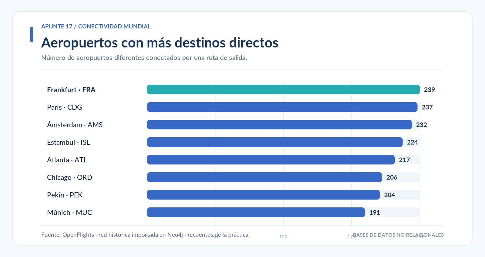{#fig-top-aeropuertos width="100%" fig-align="center"}

Como se observa en la @fig-top-aeropuertos, el aeropuerto de Frankfurt (`FRA`) presenta la mayor conectividad, con **239 destinos directos**, seguido de París Charles de Gaulle (`CDG`), con **237**, y Ámsterdam (`AMS`), con **232**.

Estos resultados permiten identificar aeropuertos con numerosas conexiones dentro de la red. Sin embargo, una mayor conectividad no significa necesariamente un mayor número de pasajeros o vuelos, ya que el análisis considera las conexiones registradas y no su frecuencia de operación.


## Recorridos con escalas

En una red de transporte aéreo, no todos los destinos se encuentran conectados directamente. Algunos requieren pasar por uno o más aeropuertos intermedios.

Para analizar estos recorridos es importante distinguir entre **tramos** y **escalas**:

| Recorrido | Tramos | Escalas |
|---|---:|---:|
| MEX → Destino | 1 | 0 |
| MEX → Aeropuerto intermedio → Destino | 2 | 1 |
| MEX → Escala 1 → Escala 2 → Destino | 3 | 2 |

Un **tramo** corresponde a una conexión entre dos aeropuertos, mientras que una **escala** representa un aeropuerto intermedio dentro del recorrido.

### Identificar destinos con hasta una escala

Para encontrar aeropuertos alcanzables desde Ciudad de México (`MEX`) mediante uno o dos tramos, se utiliza la siguiente consulta:

```sql
MATCH (origen:Aeropuerto {iata: 'MEX'})
MATCH camino =
      (origen)-[:RUTA_AEREA*1..2]->(destino:Aeropuerto)
WHERE destino <> origen
  AND destino.iata IS NOT NULL
WITH destino,
     min(length(camino)) AS TramosMinimos
RETURN destino.iata AS Codigo,
       destino.ciudad AS Ciudad,
       destino.pais AS Pais,
       TramosMinimos
ORDER BY TramosMinimos, Pais, Ciudad
LIMIT 20;
```

La expresión `*1..2` permite recorrer entre **una y dos relaciones consecutivas**, es decir, identificar conexiones directas o recorridos con una escala.

Por su parte, `length(camino)` obtiene el número de tramos de cada recorrido, mientras que `min()` identifica la menor cantidad de tramos encontrada para llegar a cada destino.

La consulta organiza los resultados de menor a mayor cantidad de tramos. Por esta razón, los primeros registros pueden corresponder únicamente a conexiones directas.

Para consultar específicamente los destinos que requieren una escala como recorrido mínimo, se puede utilizar:

```sql
MATCH (origen:Aeropuerto {iata: 'MEX'})
MATCH camino =
      (origen)-[:RUTA_AEREA*1..2]->(destino:Aeropuerto)
WHERE destino <> origen
  AND destino.iata IS NOT NULL
WITH destino,
     min(length(camino)) AS TramosMinimos
WHERE TramosMinimos = 2
RETURN destino.iata AS Codigo,
       destino.ciudad AS Ciudad,
       destino.pais AS Pais,
       TramosMinimos
ORDER BY Pais, Ciudad
LIMIT 20;
```

En este caso, `WHERE TramosMinimos = 2` permite mostrar únicamente los aeropuertos cuyo recorrido más corto desde MEX contiene dos tramos, equivalentes a una escala.

### Comparar destinos directos y con una escala

Además de identificar los recorridos, es posible calcular cuántos aeropuertos pueden alcanzarse según el número mínimo de tramos.

```sql
MATCH (origen:Aeropuerto {iata: 'MEX'})
MATCH camino =
      (origen)-[:RUTA_AEREA*1..2]->(destino:Aeropuerto)
WHERE destino <> origen
WITH destino,
     min(length(camino)) AS TramosMinimos
RETURN TramosMinimos,
       count(destino) AS TotalDestinos
ORDER BY TramosMinimos;
```

La consulta clasifica cada aeropuerto según la menor cantidad de tramos necesaria para llegar desde MEX y cuenta los destinos correspondientes.

Los resultados obtenidos son:

| Tipo de conexión | Tramos mínimos | Destinos |
|---|---:|---:|
| Directa | 1 | 93 |
| Con una escala | 2 | 956 |
| **Total de destinos alcanzables** | **Máximo 2** | **1,049** |

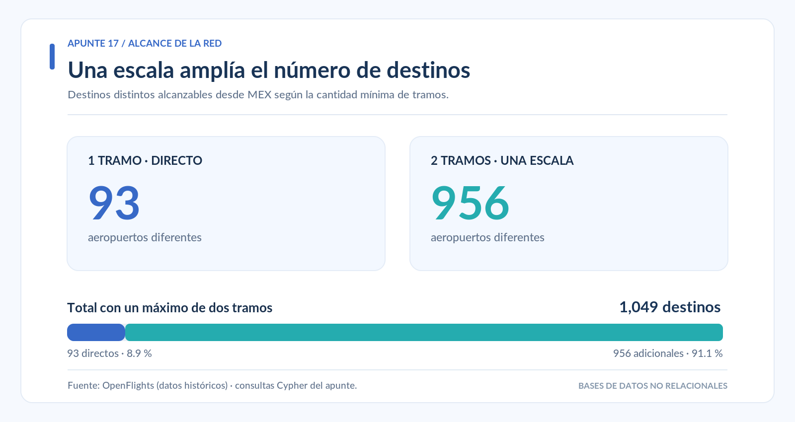{#fig-alcance-tramos width="100%" fig-align="center"}

Como se observa en la @fig-alcance-tramos, el aeropuerto de Ciudad de México tiene **93 destinos directos**. Al permitir una escala, se incorporan **956 destinos adicionales**, alcanzando un total de **1,049 aeropuertos distintos** dentro de la red histórica analizada.

Estos resultados representan **destinos únicos y no la cantidad de recorridos posibles**. Un mismo aeropuerto puede alcanzarse mediante diferentes conexiones, pero se contabiliza una sola vez según la menor cantidad de tramos encontrada.

Por lo tanto, permitir una escala amplía considerablemente el número de destinos que pueden alcanzarse desde un aeropuerto, mostrando la importancia de las conexiones indirectas en una red de transporte aéreo.


## Recuperar caminos completos

En las consultas anteriores se identificaron los destinos alcanzables desde un aeropuerto y la cantidad mínima de tramos necesarios para llegar a ellos. Sin embargo, también puede ser importante conocer **qué aeropuertos forman parte de cada recorrido**.

Neo4j permite recuperar estas conexiones e identificar las diferentes alternativas para llegar a un destino.

### Identificar escalas entre Ciudad de México y Londres

Para conocer los recorridos de exactamente dos tramos entre Ciudad de México (`MEX`) y Londres-Heathrow (`LHR`), se utiliza la siguiente consulta:

```sql
MATCH camino =
      (:Aeropuerto {iata: 'MEX'})
      -[:RUTA_AEREA*2..2]->
      (:Aeropuerto {iata: 'LHR'})
RETURN [a IN nodes(camino) | a.iata] AS Recorrido,
       length(camino) AS Tramos
ORDER BY Recorrido
LIMIT 20;
```

La expresión `*2..2` indica que el recorrido debe contener exactamente **dos relaciones**, equivalentes a un viaje con una escala.

Por su parte, `nodes(camino)` recupera los aeropuertos que forman el recorrido. La expresión `[a IN nodes(camino) | a.iata]` permite mostrar sus códigos IATA en el orden en que aparecen.

De esta manera, cada resultado presenta una secuencia de tres aeropuertos: origen, escala y destino.

También es posible consultar directamente la información del aeropuerto donde se realiza la escala:

```sql
MATCH (:Aeropuerto {iata: 'MEX'})
      -[:RUTA_AEREA]->(escala:Aeropuerto)
      -[:RUTA_AEREA]->(:Aeropuerto {iata: 'LHR'})
RETURN escala.iata AS CodigoEscala,
       escala.nombre AS AeropuertoEscala,
       escala.ciudad AS Ciudad,
       escala.pais AS Pais
ORDER BY Pais, Ciudad
LIMIT 20;
```

En esta segunda consulta, el nodo `escala` representa el aeropuerto intermedio. Esto permite conocer su nombre, ciudad y país sin necesidad de recuperar el recorrido completo.

### Encontrar el camino mínimo con `shortestPath()`

Aunque existan diferentes alternativas para llegar a un destino, puede interesar identificar el recorrido que utiliza **el menor número de tramos**.

Para ello, Neo4j dispone de la función `shortestPath()`.

```sql
MATCH (origen:Aeropuerto {iata: 'MEX'}),
      (destino:Aeropuerto {iata: 'LHR'})
MATCH camino = shortestPath(
      (origen)-[:RUTA_AEREA*1..4]->(destino)
)
RETURN [a IN nodes(camino) | a.iata] AS Recorrido,
       length(camino) AS Tramos;
```

La función busca un camino mínimo entre ambos aeropuertos, considerando recorridos de uno a cuatro tramos.

**Resultado obtenido:**

| Recorrido | Tramos |
|---|---:|
| MEX → LHR | 1 |

En este caso, existe una conexión directa entre Ciudad de México y Londres-Heathrow. Por lo tanto, el camino mínimo requiere un solo tramo, aunque también existan alternativas con escalas.

### Encontrar todos los caminos mínimos con `allShortestPaths()`

En algunos casos pueden existir diferentes recorridos con la misma cantidad mínima de tramos.

La función `allShortestPaths()` permite recuperar todas esas alternativas.

Como ejemplo, se analizarán los recorridos entre Ciudad de México (`MEX`) y Johannesburgo (`JNB`).

```sql
MATCH (origen:Aeropuerto {iata: 'MEX'}),
      (destino:Aeropuerto {iata: 'JNB'})
MATCH camino = allShortestPaths(
      (origen)-[:RUTA_AEREA*1..4]->(destino)
)
RETURN [a IN nodes(camino) | a.iata] AS Recorrido,
       [a IN nodes(camino) | a.ciudad] AS Ciudades,
       length(camino) AS Tramos
ORDER BY Recorrido;
```

La consulta busca los recorridos con la menor cantidad de tramos entre ambos aeropuertos y devuelve sus códigos IATA, las ciudades correspondientes y la longitud de cada camino.

**Resultado de referencia: 8 recorridos mínimos, todos de dos tramos.**

Esto significa que, dentro de la red analizada, es posible llegar de Ciudad de México a Johannesburgo utilizando una escala, con diferentes aeropuertos como punto de conexión.

::: {.callout-important}
## ¿Qué significa un camino mínimo?

En estas consultas, un **camino mínimo** es aquel que utiliza la menor cantidad de relaciones entre el origen y el destino.

Esto no significa necesariamente que sea el recorrido más corto en kilómetros, el más rápido o el más económico.

Para comparar estos otros criterios será necesario utilizar las propiedades de distancia, tiempo y precio incorporadas anteriormente a las relaciones `RUTA_AEREA`.
:::


## Condiciones sobre los recorridos

Además de identificar caminos entre dos aeropuertos, Neo4j permite establecer condiciones para seleccionar recorridos según los países que atraviesan o las características de sus conexiones.

Para ello se utilizarán las funciones `none()`, `any()`, `all()` y `reduce()`, aplicadas a los recorridos entre Ciudad de México (`MEX`) y Johannesburgo (`JNB`).

### Excluir aeropuertos de un país con `none()`

La función `none()` permite comprobar que ningún elemento de una lista cumpla una condición.

Por ejemplo, para encontrar los caminos mínimos entre MEX y JNB que **no pasan por aeropuertos de Estados Unidos**, se utiliza:

```sql
MATCH (origen:Aeropuerto {iata: 'MEX'}),
      (destino:Aeropuerto {iata: 'JNB'})
MATCH camino = allShortestPaths(
      (origen)-[:RUTA_AEREA*1..4]->(destino)
)
WHERE none(a IN nodes(camino)
           WHERE a.pais = 'United States')
RETURN [a IN nodes(camino) | a.iata] AS Recorrido,
       [a IN nodes(camino) | a.ciudad] AS Ciudades,
       [a IN nodes(camino) | a.pais] AS Paises,
       length(camino) AS Tramos
ORDER BY Recorrido;
```

La expresión `nodes(camino)` recupera los aeropuertos de cada recorrido, mientras que `none()` verifica que ninguno pertenezca a Estados Unidos.

**Resultado de referencia:** seis caminos mínimos, todos con una escala.

| Recorrido | Ciudad de escala |
|---|---|
| MEX → AMS → JNB | Ámsterdam |
| MEX → CDG → JNB | París |
| MEX → FRA → JNB | Frankfurt |
| MEX → GRU → JNB | São Paulo |
| MEX → LHR → JNB | Londres |
| MEX → MUC → JNB | Múnich |

De los ocho caminos mínimos identificados anteriormente, seis cumplen la condición establecida.

### Identificar escalas en un país con `any()`

La función `any()` comprueba si **al menos un elemento** de una lista cumple una condición.

Para identificar los caminos mínimos entre MEX y JNB que incluyen una escala en Alemania, ejecutar:

```sql
MATCH (origen:Aeropuerto {iata: 'MEX'}),
      (destino:Aeropuerto {iata: 'JNB'})
MATCH camino = allShortestPaths(
      (origen)-[:RUTA_AEREA*1..4]->(destino)
)
WHERE any(a IN nodes(camino)
          WHERE a.pais = 'Germany')
RETURN [a IN nodes(camino) | a.iata] AS Recorrido,
       [a IN nodes(camino) | a.ciudad] AS Ciudades,
       length(camino) AS Tramos
ORDER BY Recorrido;
```

La consulta recupera dos alternativas: **MEX → FRA → JNB**, con escala en Frankfurt, y **MEX → MUC → JNB**, con escala en Múnich.

Ambos recorridos contienen dos tramos y cumplen la condición de pasar por un aeropuerto de Alemania.

### Establecer una distancia máxima por tramo con `all()`

La función `all()` permite comprobar que **todos los elementos** de una lista cumplan una condición.

En este ejemplo se buscarán caminos mínimos con escala en Alemania, estableciendo que cada tramo tenga una distancia geográfica aproximada de **10,000 km como máximo**.

```sql
MATCH (origen:Aeropuerto {iata: 'MEX'}),
      (destino:Aeropuerto {iata: 'JNB'})
MATCH camino = allShortestPaths(
      (origen)-[:RUTA_AEREA*1..4]->(destino)
)
WHERE any(a IN nodes(camino)
          WHERE a.pais = 'Germany')
  AND all(r IN relationships(camino)
          WHERE point.distance(
            startNode(r).ubicacion,
            endNode(r).ubicacion
          ) <= 10000000)
RETURN [a IN nodes(camino) | a.iata] AS Recorrido,
       [r IN relationships(camino) |
          round(point.distance(
            startNode(r).ubicacion,
            endNode(r).ubicacion
          ) / 1000.0)
       ] AS DistanciasPorTramoKM,
       length(camino) AS Tramos
ORDER BY Recorrido;
```

La función `relationships(camino)` recupera las relaciones de cada recorrido. Posteriormente, `point.distance()` calcula la distancia geográfica aproximada entre los aeropuertos de cada tramo.

Como la distancia se obtiene en metros, se utiliza el valor `10000000` para establecer un límite equivalente a 10,000 km.

**Resultados obtenidos:**

| Recorrido | Primer tramo | Segundo tramo |
|---|---:|---:|
| MEX → FRA → JNB | 9,563 km | 8,700 km |
| MEX → MUC → JNB | 9,856 km | 8,454 km |

Ambos recorridos cumplen la condición porque ninguno de sus tramos supera los 10,000 km.

Sin embargo, esto no significa que la distancia total sea inferior a ese límite. La condición se aplica **individualmente a cada tramo**, no al recorrido completo.

### Calcular la distancia total con `reduce()`

Para conocer la distancia total de un recorrido es necesario sumar las distancias de todos sus tramos.

La función `reduce()` permite acumular estos valores y obtener un resultado único para cada camino.

En el siguiente ejemplo se seleccionarán los recorridos con escala en Alemania cuya distancia total no supere **18,300 km**.

```sql
MATCH (origen:Aeropuerto {iata: 'MEX'}),
      (destino:Aeropuerto {iata: 'JNB'})
MATCH camino = allShortestPaths(
      (origen)-[:RUTA_AEREA*1..4]->(destino)
)
WHERE any(a IN nodes(camino)
          WHERE a.pais = 'Germany')
WITH camino,
     reduce(km = 0.0, r IN relationships(camino) |
       km + point.distance(
         startNode(r).ubicacion,
         endNode(r).ubicacion
       ) / 1000.0
     ) AS DistanciaTotalKM
WHERE DistanciaTotalKM <= 18300
RETURN [a IN nodes(camino) | a.iata] AS Recorrido,
       length(camino) AS Tramos,
       round(DistanciaTotalKM) AS DistanciaTotalKM
ORDER BY DistanciaTotalKM;
```

La función `reduce()` inicia con un acumulador de `0.0` y suma la distancia de cada relación hasta obtener la distancia total del camino.

Los recorridos identificados presentan las siguientes distancias aproximadas:

| Recorrido | Distancia total | ¿Cumple el límite? |
|---|---:|---|
| MEX → FRA → JNB | 18,262 km | Sí |
| MEX → MUC → JNB | 18,310 km | No |

Por lo tanto, únicamente se recupera el recorrido **MEX → FRA → JNB**, cuya distancia total es inferior al límite establecido.

Este ejemplo permite distinguir entre una condición aplicada a cada tramo y otra aplicada a la distancia acumulada del recorrido.

---

## Coordenadas y comparación de distancias

La red de aeropuertos también permite realizar consultas geográficas. Durante la importación se almacenaron las coordenadas de cada aeropuerto mediante las propiedades `latitud`, `longitud` y `ubicacion`.

Esta última utiliza el tipo de dato geográfico `Point` de Neo4j, que permite calcular distancias entre ubicaciones.

### Comprobar las ubicaciones geográficas

Para consultar las coordenadas de los aeropuertos de Ciudad de México (`MEX`), São Paulo (`GRU`) y Johannesburgo (`JNB`), ejecutar:

```sql
MATCH (a:Aeropuerto)
WHERE a.iata IN ['MEX', 'GRU', 'JNB']
RETURN a.iata AS Codigo,
       a.ciudad AS Ciudad,
       a.latitud AS Latitud,
       a.longitud AS Longitud,
       a.ubicacion AS Ubicacion
ORDER BY Codigo;
```

**Resultados de referencia:**

| Código | Latitud | Longitud |
|---|---:|---:|
| GRU | -23.435556 | -46.473057 |
| JNB | -26.139200 | 28.246000 |
| MEX | 19.436300 | -99.072098 |

La propiedad `ubicacion` almacena las coordenadas mediante el sistema geográfico **SRID 4326**, donde `x` representa la longitud y `y` la latitud.

Con estos datos, la función `point.distance()` permite calcular la distancia geográfica aproximada entre dos aeropuertos. Para expresar el resultado en kilómetros, se divide entre 1,000.

### Comparar las distancias de seis recorridos mínimos

Anteriormente se identificaron seis caminos mínimos entre Ciudad de México y Johannesburgo que no pasan por aeropuertos de Estados Unidos.

Aunque todos contienen **dos tramos y una escala**, sus distancias geográficas pueden ser diferentes.

Para compararlos, se utiliza la siguiente consulta:

```sql
MATCH (origen:Aeropuerto {iata: 'MEX'}),
      (destino:Aeropuerto {iata: 'JNB'})
MATCH camino = allShortestPaths(
      (origen)-[:RUTA_AEREA*1..4]->(destino)
)
WHERE none(a IN nodes(camino)
           WHERE a.pais = 'United States')
WITH camino,
     reduce(km = 0.0, r IN relationships(camino) |
       km + point.distance(
         startNode(r).ubicacion,
         endNode(r).ubicacion
       ) / 1000.0
     ) AS DistanciaKM
RETURN [a IN nodes(camino) | a.iata] AS Recorrido,
       length(camino) AS Tramos,
       round(DistanciaKM) AS DistanciaKM
ORDER BY DistanciaKM ASC;
```

La consulta recupera los caminos mínimos que cumplen la restricción geográfica, calcula la distancia acumulada de sus tramos y ordena los resultados de menor a mayor.

**Resultados obtenidos:**

| Recorrido | Tramos | Distancia aproximada |
|---|---:|---:|
| MEX → GRU → JNB | 2 | 14,889 km |
| MEX → CDG → JNB | 2 | 17,957 km |
| MEX → LHR → JNB | 2 | 17,999 km |
| MEX → AMS → JNB | 2 | 18,244 km |
| MEX → FRA → JNB | 2 | 18,262 km |
| MEX → MUC → JNB | 2 | 18,310 km |

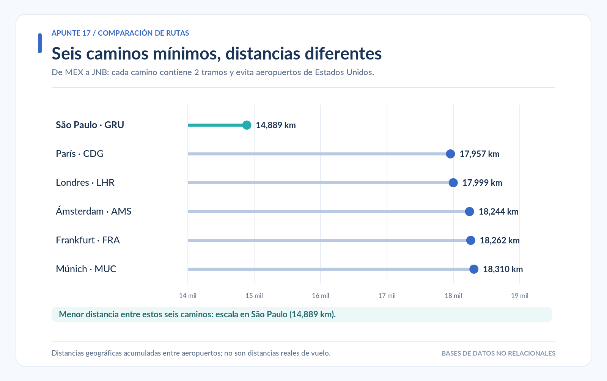{#fig-distancias-jnb width="100%" fig-align="center"}

Como se observa en la @fig-distancias-jnb, los seis recorridos tienen la misma cantidad de tramos, pero presentan distancias diferentes.

La alternativa que pasa por São Paulo (`GRU`) registra la menor distancia acumulada, con aproximadamente **14,889 km**, seguida de la ruta por París (`CDG`), con **17,957 km**.

Esta comparación demuestra que **dos caminos con igual número de tramos no necesariamente tienen la misma distancia geográfica**.

Sin embargo, el recorrido por São Paulo es el más corto en kilómetros únicamente entre las seis alternativas examinadas. No se ha demostrado que sea el camino de menor distancia entre todos los recorridos posibles de la red.

::: {.callout-warning}
## Interpretación de las distancias

Las distancias corresponden a aproximaciones geográficas calculadas entre las coordenadas de los aeropuertos. No consideran las trayectorias reales de los aviones, condiciones meteorológicas, restricciones del espacio aéreo ni tiempos de espera durante las escalas.

Además, las consultas seleccionan primero los caminos con menor número de tramos mediante `allShortestPaths()` y después comparan sus distancias. No realizan una búsqueda general del camino óptimo por distancia, tiempo o precio.
:::


## Análisis descriptivo de la red aérea

Además de identificar recorridos entre aeropuertos, Neo4j permite analizar la distribución y conectividad de la red mediante consultas de agrupación y conteo.

En esta sección se examinarán los aeropuertos registrados por país, las principales conexiones de México y la distribución de destinos nacionales e internacionales.

### Países con mayor número de aeropuertos

Para identificar los 15 países con más aeropuertos registrados en la base de datos, se utiliza:

```sql
MATCH (a:Aeropuerto)
RETURN a.pais AS Pais,
       count(a) AS TotalAeropuertos
ORDER BY TotalAeropuertos DESC
LIMIT 15;
```

La función `count()` contabiliza los aeropuertos de cada país, mientras que `ORDER BY ... DESC` organiza los resultados de mayor a menor.

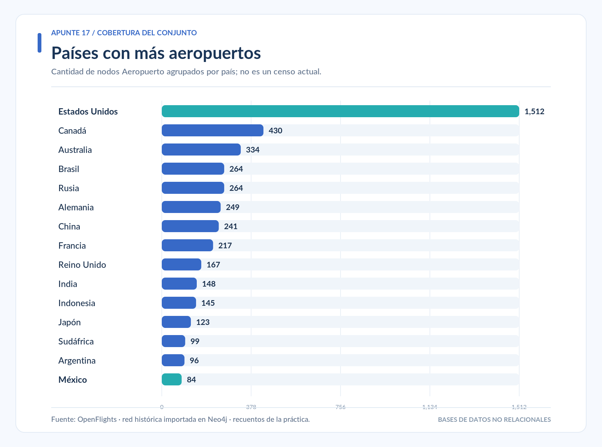{#fig-paises-aeropuertos width="100%" fig-align="center"}

Como se observa en la @fig-paises-aeropuertos, **Estados Unidos ocupa el primer lugar con 1,512 aeropuertos**, mientras que México aparece en la posición 15, con **84 aeropuertos registrados**.

Estas cifras corresponden al conjunto histórico importado y no representan necesariamente la cantidad actual de aeropuertos en cada país.

### Aeropuertos mexicanos con mayor conectividad

Una vez identificada la distribución por países, es posible analizar cuáles son los aeropuertos de México que cuentan con más destinos directos.

```sql
MATCH (a:Aeropuerto {pais: 'Mexico'})
OPTIONAL MATCH (a)-[:RUTA_AEREA]->(destino:Aeropuerto)
RETURN a.iata AS Codigo,
       a.nombre AS Aeropuerto,
       a.ciudad AS Ciudad,
       count(DISTINCT destino) AS DestinosDirectos
ORDER BY DestinosDirectos DESC
LIMIT 15;
```

En esta consulta se utiliza `OPTIONAL MATCH`, que permite conservar los aeropuertos mexicanos incluso cuando no tienen conexiones registradas. En esos casos, el número de destinos será cero.

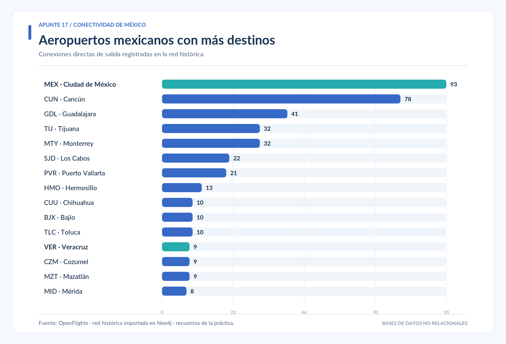{#fig-mex-conectividad width="100%" fig-align="center"}

La @fig-mex-conectividad muestra que el Aeropuerto Internacional de Ciudad de México (`MEX`) encabeza la lista con **93 destinos directos**, seguido de Cancún (`CUN`) con **78** y Guadalajara (`GDL`) con **41**.

El aeropuerto de Veracruz (`VER`) registra **9 destinos directos** dentro de esta red histórica.

Estos resultados permiten comparar la conectividad de los aeropuertos, aunque no indican la frecuencia de vuelos ni el número de pasajeros transportados.

### Distribución de destinos por país desde MEX

También es posible identificar hacia qué países se distribuyen las conexiones directas desde Ciudad de México.

```sql
MATCH (:Aeropuerto {iata: 'MEX'})
      -[:RUTA_AEREA]->(destino:Aeropuerto)
RETURN destino.pais AS Pais,
       count(DISTINCT destino) AS DestinosDirectos
ORDER BY DestinosDirectos DESC, Pais;
```

La consulta agrupa los aeropuertos de destino según su país y contabiliza cuántas conexiones directas existen hacia cada uno.

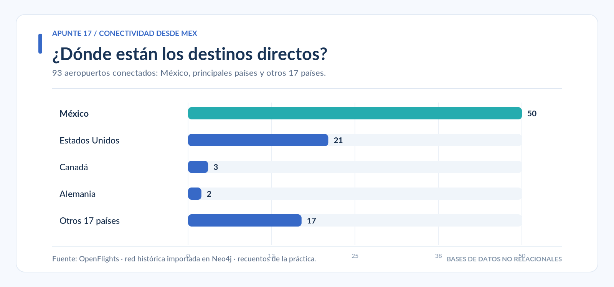{#fig-mex-por-pais width="100%" fig-align="center"}

Los **93 destinos directos** desde MEX se encuentran distribuidos en **21 países**, incluido México.

La mayor cantidad corresponde a destinos nacionales, con **50 aeropuertos**, seguidos de Estados Unidos con **21**, Canadá con **3** y Alemania con **2**. Los 17 destinos restantes se distribuyen entre otros 17 países.

### Clasificar destinos nacionales e internacionales con `CASE`

La expresión `CASE` permite clasificar los registros de acuerdo con una condición.

En este ejemplo, los destinos se agruparán en dos categorías: **Nacional** e **Internacional**.

```sql
MATCH (:Aeropuerto {iata: 'MEX'})
      -[:RUTA_AEREA]->(destino:Aeropuerto)
WITH CASE
       WHEN destino.pais = 'Mexico' THEN 'Nacional'
       ELSE 'Internacional'
     END AS TipoDestino,
     destino
RETURN TipoDestino,
       count(DISTINCT destino) AS TotalAeropuertos
ORDER BY TotalAeropuertos DESC;
```

La consulta comprueba el país de cada aeropuerto. Si corresponde a México, se clasifica como `Nacional`; de lo contrario, se asigna la categoría `Internacional`.

Los resultados son:

| Tipo de destino | Aeropuertos | Porcentaje |
|---|---:|---:|
| Nacional | 50 | 53.8 % |
| Internacional | 43 | 46.2 % |
| **Total** | **93** | **100 %** |

Los porcentajes se calculan sobre el total de destinos directos desde MEX.

### Destinos nacionales e internacionales con una escala

Anteriormente se identificó que, al permitir hasta una escala desde MEX, el número de destinos alcanzables aumenta de 93 a 1,049.

Ahora se analizará cómo se distribuyen estos destinos entre nacionales e internacionales, según el número mínimo de tramos.

```sql
MATCH (origen:Aeropuerto {iata: 'MEX'})
MATCH camino =
      (origen)-[:RUTA_AEREA*1..2]->(destino:Aeropuerto)
WHERE destino <> origen
WITH destino,
     min(length(camino)) AS TramosMinimos
WITH TramosMinimos,
     CASE
       WHEN destino.pais = 'Mexico' THEN 'Nacional'
       ELSE 'Internacional'
     END AS TipoDestino,
     count(destino) AS TotalAeropuertos
RETURN TramosMinimos,
       TipoDestino,
       TotalAeropuertos
ORDER BY TramosMinimos, TipoDestino;
```

La consulta identifica la menor cantidad de tramos para llegar a cada aeropuerto y posteriormente clasifica los destinos como nacionales o internacionales.

**Resultados obtenidos:**

| Tramos mínimos | Nacionales | Internacionales | Total |
|---|---:|---:|---:|
| 1 (sin escala) | 50 | 43 | 93 |
| 2 (una escala) | 5 | 951 | 956 |
| **Total** | **55** | **994** | **1,049** |

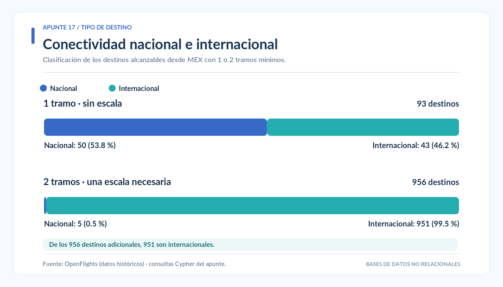{#fig-tipo-destino width="100%" fig-align="center"}

La @fig-tipo-destino muestra que la mayor parte de los destinos adicionales alcanzables mediante una escala son internacionales: **951 de los 956 destinos** que requieren dos tramos como recorrido mínimo.

En cambio, solamente cinco aeropuertos mexicanos se encuentran dentro de esta categoría.

Para identificarlos, se utiliza la siguiente consulta:

```sql
MATCH (origen:Aeropuerto {iata: 'MEX'})
MATCH camino =
      (origen)-[:RUTA_AEREA*1..2]->(destino:Aeropuerto)
WHERE destino <> origen
  AND destino.pais = 'Mexico'
WITH destino,
     min(length(camino)) AS TramosMinimos
WHERE TramosMinimos = 2
RETURN destino.iata AS Codigo,
       destino.nombre AS Aeropuerto,
       destino.ciudad AS Ciudad,
       TramosMinimos
ORDER BY Ciudad;
```

Los aeropuertos identificados son:

| Código IATA | Ciudad |
|---|---|
| LTO | Loreto |
| PBC | Puebla |
| QRO | Querétaro |
| TLC | Toluca |
| UPN | Uruapan |

De acuerdo con las conexiones históricas registradas en la base de datos, estos aeropuertos pueden alcanzarse desde MEX mediante dos tramos, pero no cuentan con una conexión directa registrada desde ese origen.

::: {.callout-note}
## Interpretación de los resultados

Los análisis describen la conectividad del conjunto histórico de OpenFlights. La ausencia de una conexión directa no significa que actualmente no existan vuelos entre dos aeropuertos.

Asimismo, los destinos alcanzables representan aeropuertos distintos y no el número de vuelos, pasajeros o itinerarios disponibles.
:::


## Análisis de tiempos, costos y precios simulados

Los recorridos también pueden compararse mediante las propiedades incorporadas desde `rutas_costos_precios_simulados.csv`. En este archivo, el **costo operativo** representa un gasto hipotético por asiento, mientras que el **precio del boleto** es el importe ficticio que pagaría un pasajero. Son conceptos diferentes.

### Comparar alternativas entre MEX y JNB

La siguiente consulta parte de los seis caminos mínimos que no pasan por Estados Unidos y suma los valores simulados de cada tramo, siempre que las propiedades estén disponibles:

```sql
MATCH (origen:Aeropuerto {iata: 'MEX'}),
      (destino:Aeropuerto {iata: 'JNB'})
MATCH camino = allShortestPaths(
      (origen)-[:RUTA_AEREA*1..4]->(destino)
)
WHERE none(a IN nodes(camino)
           WHERE a.pais = 'United States')
  AND all(r IN relationships(camino)
          WHERE r.precio_boleto_simulado_mxn IS NOT NULL
            AND r.costo_operativo_simulado_por_asiento_mxn IS NOT NULL
            AND r.tiempo_vuelo_simulado_min IS NOT NULL)
WITH camino,
     reduce(precio = 0, r IN relationships(camino) |
       precio + r.precio_boleto_simulado_mxn
     ) AS PrecioTotalMXN,
     reduce(costo = 0, r IN relationships(camino) |
       costo + r.costo_operativo_simulado_por_asiento_mxn
     ) AS CostoTotalMXN,
     reduce(tiempo = 0, r IN relationships(camino) |
       tiempo + r.tiempo_vuelo_simulado_min
     ) AS TiempoTotalMin
RETURN [a IN nodes(camino) | a.iata] AS Recorrido,
       length(camino) AS Tramos,
       CostoTotalMXN,
       PrecioTotalMXN,
       TiempoTotalMin
ORDER BY PrecioTotalMXN ASC;
```

La función `reduce()` suma los valores de las relaciones que integran cada recorrido. `all()` comprueba que todos los tramos tengan las propiedades necesarias, y `ORDER BY` presenta primero el menor precio simulado.

Los resultados permiten comparar recorridos con el mismo número de tramos, pero con distintos precios, costos y tiempos. Para ordenar por duración, se puede modificar la última línea de la consulta a `ORDER BY TiempoTotalMin ASC`.

::: {.callout-warning}
**Interpretación de los valores simulados.** Las cifras se generaron con fines didácticos. El tiempo acumulado no incluye la espera durante las escalas y la suma de precios por tramo no equivale a una tarifa comercial de conexión. Además, la consulta compara únicamente los caminos mínimos previamente seleccionados, no todos los itinerarios posibles.
:::

## Rendimiento de las consultas: `EXPLAIN`, `PROFILE` e índices

Cuando aumenta el tamaño de la red, resulta importante conocer no solo los resultados de una consulta, sino también el trabajo que realiza Neo4j para obtenerlos.

### Examinar el plan con `EXPLAIN`

`EXPLAIN` muestra el plan de ejecución estimado sin recuperar los resultados de la consulta.

```sql
EXPLAIN
MATCH (origen:Aeropuerto {iata: 'MEX'})
      -[:RUTA_AEREA]->(destino:Aeropuerto)
RETURN destino.iata AS Codigo,
       destino.nombre AS Aeropuerto
LIMIT 10;
```

En el plan obtenido antes de crear el índice IATA, `NodeByLabelScan` examina nodos `Aeropuerto`; posteriormente, `Filter` identifica el código buscado y `Expand(All)` recorre las conexiones de salida.

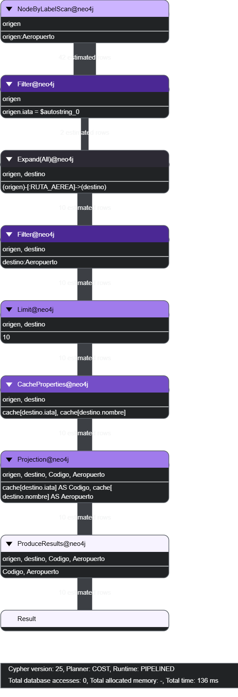{#fig-explain width="70%" fig-align="center"}

### Medir la ejecución con `PROFILE`

A diferencia de `EXPLAIN`, `PROFILE` **sí ejecuta** la consulta y registra indicadores, entre ellos los accesos lógicos a la base de datos (`DB hits`).

```sql
PROFILE
MATCH (origen:Aeropuerto {iata: 'MEX'})
      -[:RUTA_AEREA]->(destino:Aeropuerto)
RETURN destino.iata AS Codigo,
       destino.nombre AS Aeropuerto
LIMIT 10;
```

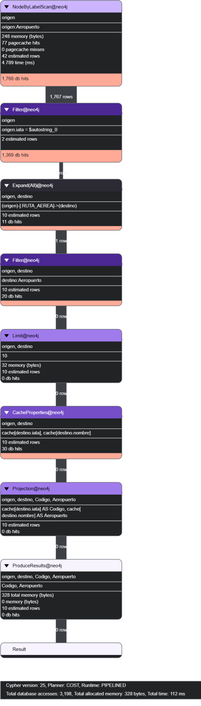{#fig-profile-sin-indice width="70%" fig-align="center"}

En la ejecución de referencia, el operador de búsqueda examinó **1,767 filas** y el plan registró **3,198 DB hits**. Este indicador contabiliza operaciones lógicas sobre la base de datos; no equivale al número de aeropuertos consultados ni necesariamente a lecturas físicas del disco.

### Crear un índice y comparar

Para acelerar la localización de aeropuertos por código IATA, se crea un índice:

```sql
CREATE INDEX aeropuerto_iata IF NOT EXISTS
FOR (a:Aeropuerto)
ON (a.iata);
```

Una vez que el índice esté disponible, se ejecuta **la misma consulta con `PROFILE`** y se comparan los planes.

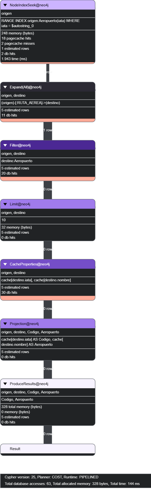{#fig-profile-con-indice width="70%" fig-align="center"}

| Indicador | Sin índice IATA | Con índice IATA |
|---|---:|---:|
| Operador de búsqueda | `NodeByLabelScan` | `NodeIndexSeek` |
| `DB hits` | 3,198 | 63 |
| Tiempo observado | 112 ms | 144 ms |
| Filas devueltas | 10 | 10 |

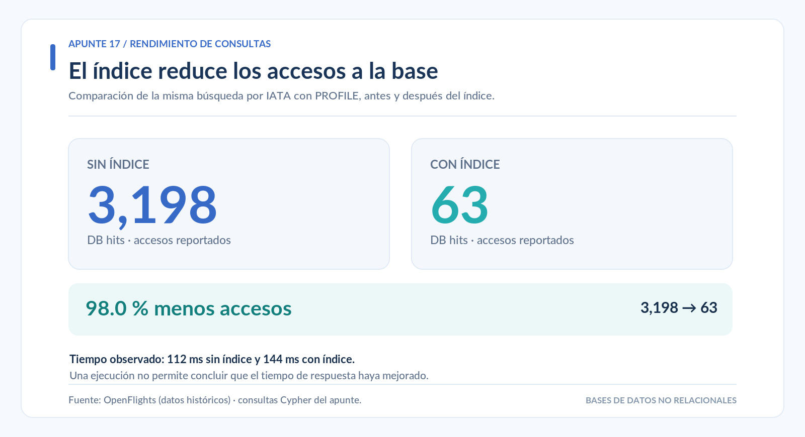{#fig-indices-db-hits width="100%" fig-align="center"}

En este ejercicio, el índice redujo los accesos lógicos aproximadamente **98 %**. Sin embargo, la medición con índice tardó más tiempo. Una ejecución aislada no permite afirmar que el tiempo de respuesta haya mejorado; este puede variar por la caché, la carga del equipo y otros factores.

::: {.callout-note}
Si el índice ya existe, Neo4j puede utilizar `NodeIndexSeek` desde la primera consulta. No es necesario eliminarlo para repetir la actividad: basta con interpretar los operadores que aparezcan en el plan real.
:::

## Visualización de rutas en Neo4j Dashboards

Las redes con miles de conexiones son difíciles de interpretar cuando se muestran completas. Por ello, es preferible visualizar primero un grupo pequeño de aeropuertos y después ampliar la exploración.

### Ubicar aeropuertos en un mapa

En **Neo4j Desktop**, se abre **Dashboards**, se crea un panel y se agrega una tarjeta de tipo **Map**. Para ubicar tres aeropuertos, se utiliza:

```sql
MATCH (a:Aeropuerto)
WHERE a.iata IN ['MEX', 'GRU', 'JNB']
RETURN a;
```

La propiedad `ubicacion`, creada durante la importación, permite situar los aeropuertos sobre el mapa. Los marcadores muestran posiciones geográficas, no conexiones.

### Mostrar un recorrido con una escala

Para representar las relaciones MEX → GRU y GRU → JNB:

```sql
MATCH (origen:Aeropuerto)-[ruta:RUTA_AEREA]->(destino:Aeropuerto)
WHERE (origen.iata = 'MEX' AND destino.iata = 'GRU')
   OR (origen.iata = 'GRU' AND destino.iata = 'JNB')
RETURN origen, ruta, destino;
```

El mapa puede mostrar tres aeropuertos unidos por dos líneas. Estas líneas indican conexiones del grafo; **no representan las trayectorias reales de los aviones**.

### Visualizar seis caminos alternativos

También pueden mostrarse los caminos mínimos de MEX a JNB que no pasan por Estados Unidos:

```sql
MATCH (origen:Aeropuerto {iata: 'MEX'}),
      (destino:Aeropuerto {iata: 'JNB'})
MATCH camino = allShortestPaths(
      (origen)-[:RUTA_AEREA*1..4]->(destino)
)
WHERE none(a IN nodes(camino)
           WHERE a.pais = 'United States')
UNWIND relationships(camino) AS ruta
RETURN DISTINCT startNode(ruta) AS Origen,
                ruta AS Ruta,
                endNode(ruta) AS Destino;
```

`UNWIND` convierte las relaciones de cada camino en filas; `DISTINCT` evita mostrar repetidamente una misma conexión compartida por varios recorridos.

### Explorar una muestra de la red mundial

Una muestra de 300 conexiones permite observar la extensión geográfica del conjunto sin representar todas las rutas a la vez:

```sql
MATCH (origen:Aeropuerto)-[ruta:RUTA_AEREA]->(destino:Aeropuerto)
WITH origen, ruta, destino
ORDER BY rand()
LIMIT 300
RETURN origen, ruta, destino;
```

La selección es aleatoria, por lo que cambia en cada ejecución. En regiones con muchos aeropuertos, los marcadores pueden superponerse; en esos casos conviene reducir la muestra o filtrar por país o aeropuerto.

## Visualizador interactivo de OpenFlights

El apunte incluye un **atlas interactivo** que permite explorar aeropuertos, conexiones, filtros geográficos y alternativas de recorrido en un mapa mundial.

Este recurso utiliza los archivos de OpenFlights publicados en el sitio del curso o seleccionados desde el equipo. **No consulta directamente la base local de Neo4j** ni utiliza el archivo de costos y precios simulados.

<iframe
  src="../visualizadores/visualizador_openflights.html"
  title="Atlas interactivo de aeropuertos y rutas OpenFlights"
  loading="lazy"
  style="width:100%;height:920px;border:0;border-radius:12px;"
  allowfullscreen>
</iframe>

[Abrir el atlas en una pestaña independiente](../visualizadores/visualizador_openflights.html){target="_blank"}

Para utilizar la carga automática deben estar publicados `datasets/airports.dat` y `datasets/routes.dat`, además del archivo HTML del visualizador.

**Para observar:** ¿qué cambia entre visualizar toda la red y concentrarse en un aeropuerto?, ¿por qué se superponen algunas conexiones?, ¿qué información resulta más fácil de identificar en el mapa que en una tabla?

## Limitaciones y calidad de los datos

Los resultados deben interpretarse considerando las características de las fuentes y las decisiones de modelado:

- Las rutas de OpenFlights son **históricas** y no indican vuelos disponibles actualmente.
- Algunos registros contienen valores faltantes, representados como `\N` en los archivos originales.
- Solo se incorporan relaciones cuando existen ambos aeropuertos y sus identificadores son válidos.
- Las conexiones repetidas de diferentes aerolíneas se reúnen en una sola relación dirigida por par de aeropuertos.
- Las distancias calculadas son aproximaciones geográficas, no trayectorias de vuelo.
- Los tiempos, costos y precios del tercer archivo son **simulados**; no incluyen todos los factores de una operación comercial.
- Los conteos pueden cambiar si se utilizan otras versiones de los archivos o diferentes criterios de limpieza.

Documentar estas decisiones es fundamental para interpretar correctamente el grafo. Esta necesidad se relaciona con el siguiente tema del curso: **integración, limpieza y validación de datos**.

### Atribución de los datos

Los registros originales proceden de [OpenFlights](https://openflights.org/data.php), cuyos conjuntos de datos se distribuyen bajo la **Open Database License (ODbL)**. Al reutilizar y distribuir los datos o sus derivados deben respetarse las condiciones de atribución y licencia correspondientes.

El archivo `rutas_costos_precios_simulados.csv` es un recurso didáctico generado a partir de esos registros; sus valores económicos y temporales no proceden de OpenFlights.

## Actividad individual: análisis de la red de aeropuertos

La actividad consiste en elaborar consultas propias y explicar brevemente sus resultados. Se utilizará la base de datos construida durante la práctica y no se requieren operaciones de eliminación.

### Parte A. Datos y conectividad

1. Compruebe la lectura de los tres archivos e identifique cuáles tienen encabezados.
2. Consulte la cantidad de nodos `Aeropuerto`, relaciones `RUTA_AEREA` y relaciones con precio simulado.
3. Identifique los diez aeropuertos del mundo con más destinos directos de salida.
4. Obtenga los diez países con más aeropuertos registrados e interprete el alcance de ese resultado.
5. Identifique los cinco aeropuertos mexicanos con más destinos directos, incluyendo sus códigos y ciudades.

### Parte B. Recorridos y comparación

6. Desde `CUN`, identifique los destinos alcanzables en uno o dos tramos y registre su menor número de tramos.
7. Muestre los aeropuertos de escala de los recorridos de exactamente dos tramos entre `MEX` y `JNB`.
8. Compare `shortestPath()` y `allShortestPaths()` para el par `MEX`–`JNB`.
9. Obtenga los caminos mínimos entre `MEX` y `JNB` que no pasen por Estados Unidos.
10. Identifique los caminos mínimos entre `MEX` y `JNB` con escala en Alemania y compruebe si todos sus tramos miden **menos de 9,000 km**.
11. Compare la distancia geográfica acumulada de los caminos mínimos entre `MEX` y `JNB` que evitan Estados Unidos.
12. Compare esos mismos caminos según **precio simulado y tiempo estimado**. Indique si la alternativa más económica coincide con la más rápida en el modelo.

### Parte C. Presentación y rendimiento

13. Clasifique como nacionales e internacionales los destinos alcanzables desde `CUN` en uno o dos tramos, sin contar dos veces el mismo aeropuerto.
14. Examine con `EXPLAIN` y `PROFILE` una búsqueda por código IATA. Identifique el operador utilizado y los `DB hits`; explique la función del índice.
15. Cree en Neo4j Dashboards un mapa con al menos tres aeropuertos conectados y compárelo con el atlas interactivo del apunte.

### Indicaciones de entrega

Se entregará un **PDF** con nombre completo, las consultas Cypher de los 15 ejercicios, capturas de los resultados necesarios y una explicación breve de cada hallazgo. En la interpretación debe distinguirse entre **registros históricos** y **datos simulados**, evitando presentar cualquiera de ellos como información comercial actual.

## Resumen

En este apunte se construyó y exploró una red de aeropuertos a partir de archivos externos. Las consultas Cypher permitieron estudiar destinos directos, recorridos con escalas y caminos mínimos, además de aplicar condiciones sobre los nodos y las relaciones.

La comparación de distancias, tiempos, costos y precios simulados mostró que **tener el mismo número de tramos no implica recorrer la misma distancia ni obtener el mismo resultado bajo otros criterios**. Asimismo, `EXPLAIN` y `PROFILE` permitieron examinar el trabajo realizado por Neo4j, y las herramientas de visualización facilitaron la interpretación geográfica de las conexiones.

El análisis de una red requiere comprender tanto los resultados de las consultas como la procedencia, los supuestos y las limitaciones de los datos.

## Referencias de consulta

- OpenFlights. [Airport and airline data](https://openflights.org/data.php). Descripción de los datos y condiciones de licencia.
- OpenFlights. [Repositorio de datos](https://github.com/jpatokal/openflights).
- Neo4j. [`LOAD CSV` — Cypher Manual](https://neo4j.com/docs/cypher-manual/current/clauses/load-csv/).
- Neo4j. [Variable-length paths](https://neo4j.com/docs/cypher-manual/current/patterns/variable-length-paths/).
- Neo4j. [Shortest paths](https://neo4j.com/docs/cypher-manual/current/patterns/shortest-paths/).
- Neo4j. [Predicate functions](https://neo4j.com/docs/cypher-manual/current/functions/predicate/).
- Neo4j. [Spatial functions](https://neo4j.com/docs/cypher-manual/current/functions/spatial/).
- Neo4j. [Execution plans](https://neo4j.com/docs/cypher-manual/current/planning-and-tuning/execution-plans/).
- Neo4j. [Dashboards — Map](https://neo4j.com/docs/aura/dashboards/visualizations/map/).
- Quarto. [Creating a website](https://quarto.org/docs/websites/).
