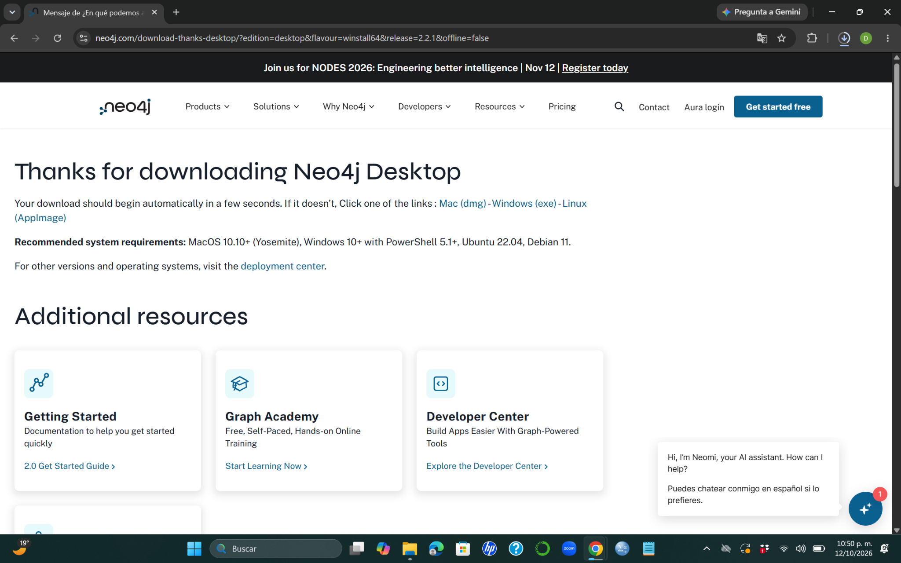
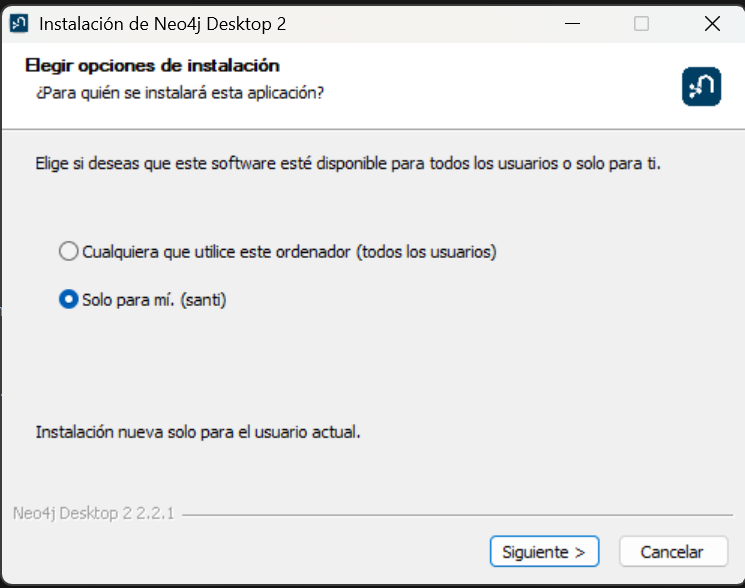
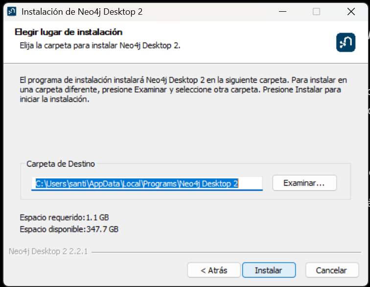
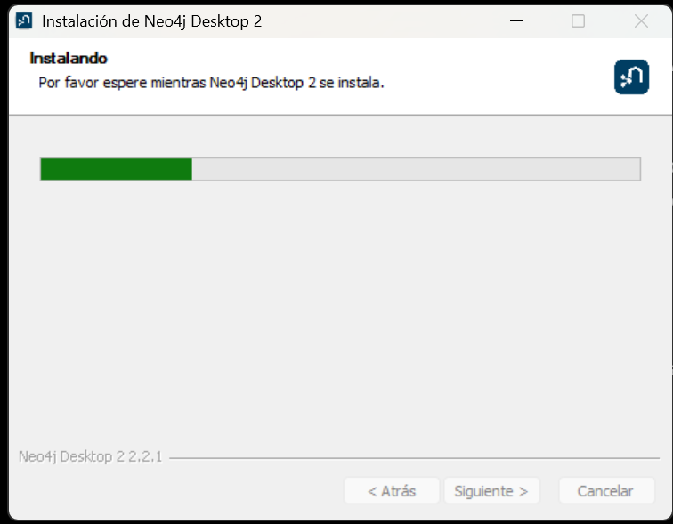
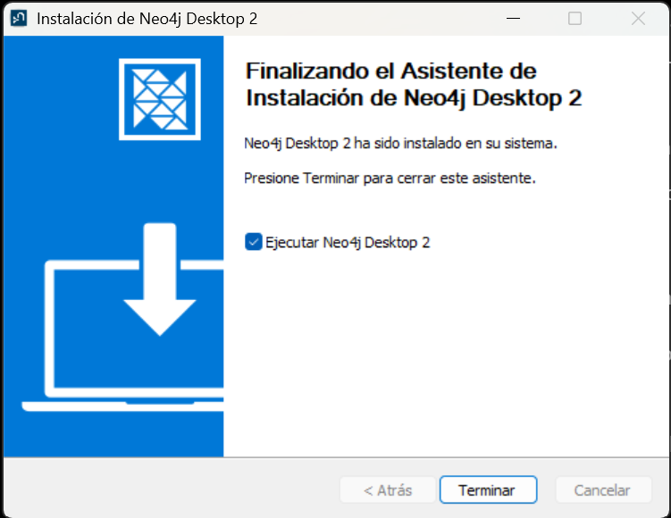
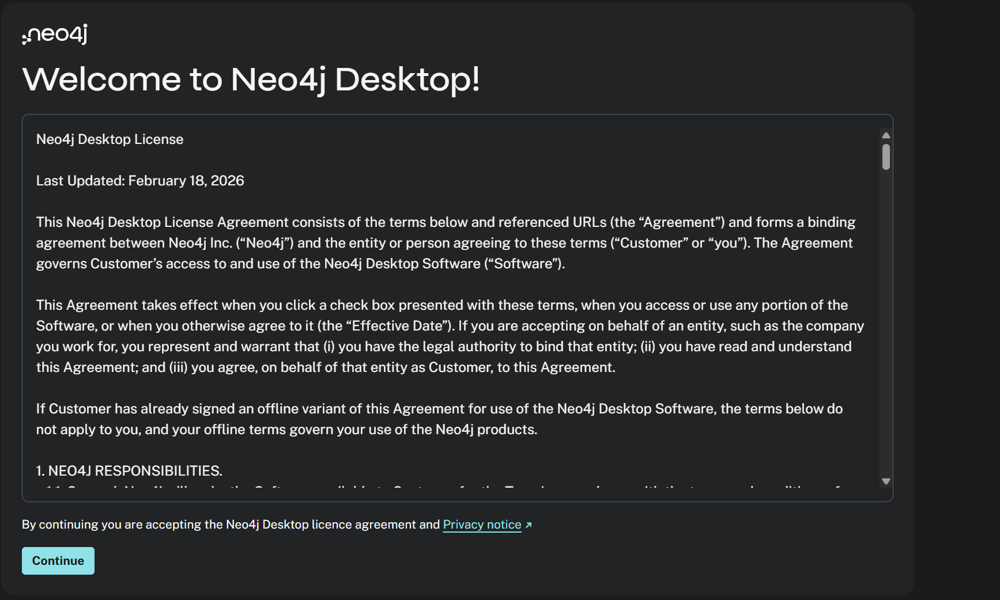
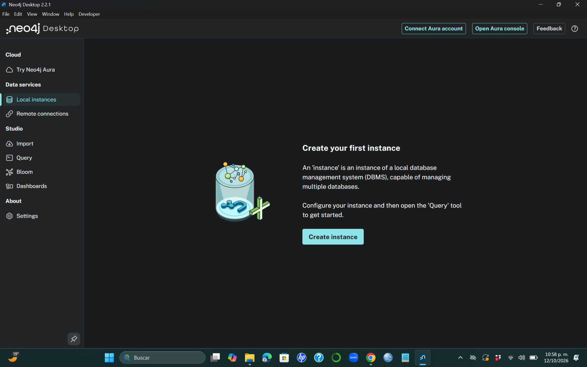

---
title: "Instalación de Neo4j Desktop en Windows"
toc: true
number-sections: true
---

## Introducción

**Neo4j** es un sistema gestor de bases de datos orientado a grafos que permite representar información mediante nodos, relaciones y propiedades.

A diferencia de otros modelos de bases de datos, Neo4j facilita la representación y consulta de conexiones entre diferentes entidades, como personas, productos, organizaciones o redes de transporte.

Para trabajar con este sistema utilizaremos **Neo4j Desktop**, una aplicación que permite administrar instancias locales de Neo4j y realizar consultas mediante el lenguaje **Cypher**.

En este manual se explica el proceso de descarga e instalación de Neo4j Desktop en Windows.

Al finalizar, tendremos la aplicación instalada y preparada para crear nuestra primera instancia local.

---

## Requisitos previos

Antes de comenzar, es necesario contar con:

- Una computadora con Windows 10 u 11.
- Conexión a Internet para descargar el instalador.
- Espacio disponible en disco.
- Permisos para instalar aplicaciones.

En el procedimiento documentado se utilizó **Neo4j Desktop 2.2.1** en Windows 11.

::: {.callout-note}
## Importante

Las pantallas pueden presentar pequeñas diferencias dependiendo de la versión de Neo4j Desktop y del sistema operativo.

El procedimiento general de instalación es similar.
:::

---

## Descargar Neo4j Desktop

Primero debemos acceder al sitio oficial de Neo4j:

https://neo4j.com/download/

En la página de descargas buscamos la opción correspondiente a **Neo4j Desktop para Windows**.

Al seleccionar la descarga, aparecerá un formulario solicitando algunos datos.

{#fig-neo4j-descarga width="95%" fig-align="center"}

Como se muestra en la @fig-neo4j-descarga, el formulario solicita:

- Nombre.
- Apellidos.
- Correo electrónico.
- Institución u organización.
- Rol o actividad.
- País.

Completa los campos solicitados y selecciona **Download Desktop**.

### Confirmar la descarga

Después de enviar el formulario, aparecerá una página de confirmación.

{#fig-neo4j-confirmacion width="95%" fig-align="center"}

En la @fig-neo4j-confirmacion podemos observar el mensaje de agradecimiento por descargar Neo4j Desktop.

Generalmente, la descarga comienza automáticamente.

Si esto no sucede, podemos utilizar el enlace **Windows (exe)** que aparece en la página.

También se muestran algunos recursos adicionales para conocer Neo4j.

{#fig-neo4j-recursos width="95%" fig-align="center"}

Estos materiales incluyen documentación, cursos y recursos para desarrolladores.

No es necesario utilizarlos para completar la instalación.

---

## Ejecutar el instalador

Cuando termine la descarga, abrimos la carpeta **Descargas** de Windows.

Localizamos el instalador de Neo4j Desktop y hacemos doble clic para ejecutarlo.

Si Windows solicita autorización para realizar cambios en el equipo, verificamos que se trate del instalador descargado desde el sitio oficial y confirmamos la operación.

Después aparecerá el asistente de instalación.

---

## Seleccionar el tipo de instalación

El instalador permite elegir para quién estará disponible la aplicación.

{#fig-neo4j-tipo-instalacion width="85%" fig-align="center"}

Como se observa en la @fig-neo4j-tipo-instalacion, existen dos posibilidades:

- **Todos los usuarios:** la aplicación estará disponible para las cuentas del equipo.
- **Solo para mí:** la aplicación se instalará para el usuario actual.

Para esta práctica seleccionamos **Solo para mí**.

Esta opción es suficiente cuando trabajamos en una computadora personal.

Posteriormente hacemos clic en **Siguiente**.

---

## Seleccionar la carpeta de instalación

El asistente solicitará indicar la ubicación donde se instalará Neo4j Desktop.

{#fig-neo4j-carpeta width="85%" fig-align="center"}

En la @fig-neo4j-carpeta se muestra la carpeta predeterminada propuesta por Windows.

No es necesario modificar esta ubicación.

En el procedimiento documentado, el instalador indicó un espacio requerido de aproximadamente **1.1 GB**.

Para continuar, hacemos clic en **Instalar**.

---

## Proceso de instalación

Después de seleccionar la carpeta de destino, comenzará la instalación.

{#fig-neo4j-progreso width="85%" fig-align="center"}

Durante este procedimiento, el asistente muestra una barra de progreso, como se observa en la @fig-neo4j-progreso.

Debemos esperar hasta que termine.

El tiempo necesario dependerá de las características del equipo.

No es necesario ejecutar comandos ni realizar configuraciones adicionales durante esta etapa.

---

## Finalizar la instalación

Cuando el instalador termine, aparecerá una pantalla indicando que Neo4j Desktop se instaló correctamente.

{#fig-neo4j-finalizacion width="85%" fig-align="center"}

En la @fig-neo4j-finalizacion aparece la opción:

**Ejecutar Neo4j Desktop 2**

Dejamos marcada esta casilla para abrir la aplicación automáticamente.

Finalmente, hacemos clic en **Terminar**.

---

## Primera ejecución de Neo4j Desktop

La primera vez que abrimos Neo4j Desktop, aparece una pantalla de bienvenida con el acuerdo de licencia.

{#fig-neo4j-licencia width="95%" fig-align="center"}

En esta pantalla podemos revisar las condiciones de uso de la aplicación.

Si estamos de acuerdo con los términos y el aviso de privacidad, hacemos clic en **Continue**.

Después de continuar, Neo4j Desktop abrirá su pantalla principal.

---

## Pantalla principal de Neo4j Desktop

Una vez completada la configuración inicial, podremos acceder a la interfaz de Neo4j Desktop.

{#fig-neo4j-principal width="100%" fig-align="center"}

Como se observa en la @fig-neo4j-principal, la aplicación presenta diferentes opciones en el menú lateral.

Entre las principales encontramos:

| Opción | Descripción |
|---|---|
| Local instances | Permite crear y administrar instancias locales de Neo4j. |
| Remote connections | Permite configurar conexiones a instancias remotas. |
| Import | Herramienta para importar datos. |
| Query | Entorno para escribir y ejecutar consultas. |
| Bloom | Herramienta para explorar visualmente grafos. |
| Dashboards | Permite trabajar con paneles de visualización. |
| Settings | Configuración de la aplicación. |

### ¿Qué es una instancia local?

Una **instancia local** es una instalación del sistema gestor Neo4j que se ejecuta en nuestra propia computadora.

Una instancia puede administrar bases de datos, permitiendo almacenar nodos, relaciones y propiedades.

En la pantalla principal aparece el botón:

**Create instance**

Este botón permite comenzar el proceso de creación de una instancia local.

::: {.callout-note}
## Diferencia entre instancia y base de datos

La **instancia** corresponde al sistema gestor Neo4j que se ejecuta en la computadora.

La **base de datos** es el espacio lógico donde almacenamos y consultamos nuestros grafos.

Una instancia puede administrar una o varias bases de datos, dependiendo de la edición y configuración utilizada.
:::

---

## Comprobación de la instalación

Para confirmar que Neo4j Desktop se instaló correctamente, verificamos que:

1. La aplicación pueda abrirse desde Windows.
2. Se muestre la pantalla principal.
3. Aparezca la sección **Local instances**.
4. Esté disponible la opción **Create instance**.

Si podemos acceder a estas opciones, la instalación de Neo4j Desktop se ha completado correctamente.

Esto confirma que la aplicación está instalada, aunque todavía falta crear y poner en funcionamiento una instancia local de Neo4j.

---

## Conclusión

En este manual realizamos el proceso de descarga e instalación de **Neo4j Desktop en Windows**.

Comenzamos accediendo al sitio oficial de Neo4j, descargamos el instalador, seleccionamos las opciones de instalación y completamos la configuración inicial.

Finalmente, identificamos la pantalla principal de la aplicación y algunas de sus herramientas.

Con Neo4j Desktop instalado, contamos con el entorno necesario para continuar con la creación de una instancia local y comenzar a trabajar con bases de datos orientadas a grafos mediante el lenguaje **Cypher**.
